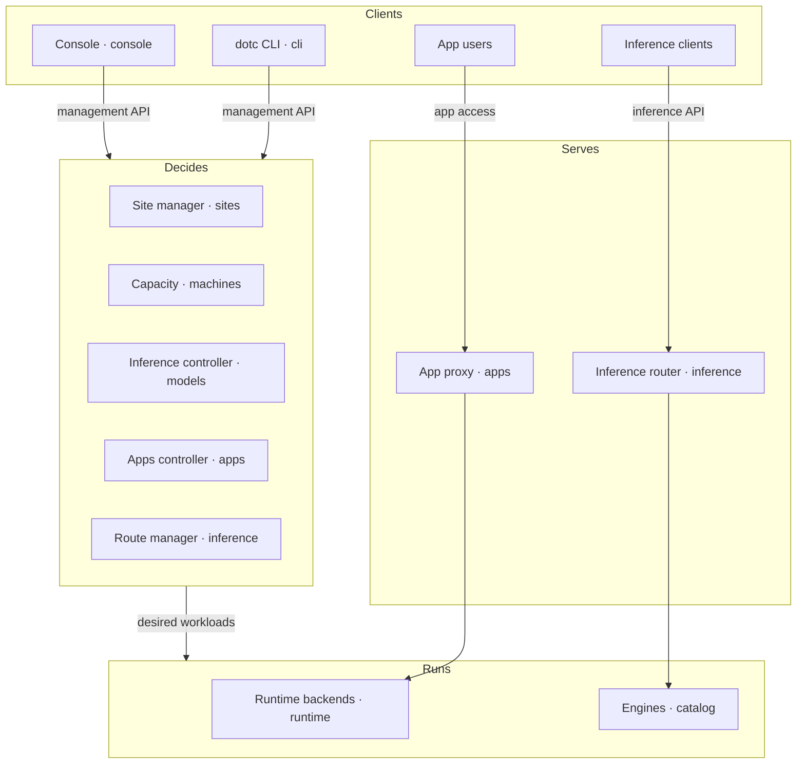

# Dotcore design

Dotcore runs AI models and apps on hardware you own. You manage it like a cloud, and it serves
every model behind one OpenAI-compatible endpoint. These pages say what Dotcore should do and how
it's built. They describe the design we're aiming for, so some of it isn't built yet. Each page
ends with a Future section: ideas that aren't committed yet, and open questions marked "Open".

## Contents

This page: [users](#users), [principles](#principles), [non-goals](#non-goals),
[main components](#main-components), [site shapes](#site-shapes), [future](#future).

| Page | What it covers |
| --- | --- |
| [CLI](cli.md) | `dotc`, for setup and scripts |
| [Console](console.md) | The web app |
| [Sites](sites.md) | A group of machines managed together, and who owns which state |
| [Machines](machines.md) | Hardware, and whether a model fits in memory |
| [Catalog](catalog.md) | Models, apps, engines and hardware classes Dotcore can deploy |
| [Models](models.md) | Running models, local or upstream |
| [Apps](apps.md) | Running apps such as Open WebUI, and how users reach them |
| [Runtime](runtime.md) | How workloads start on a machine: Docker, native or simulated |
| [Inference](inference.md) | Routes, and how a request reaches a model |
| [Storage](storage.md) | Artifacts, caches, records, app data, backups, metrics and logs |
| [Access](access.md) | Users, API keys, machine trust and secrets |

## Users

- Platform admins look after machines, capacity and maintenance.
- Model managers pick which models run and how they're configured.
- Developers build products on the served models and the hosted apps.
- Team managers decide who can use what.

## Principles

- The site runs itself. Local serving keeps working without Dotcore's services, cloud management
  or the internet.
- What you asked for and what is actually running are shown separately, along with anything in
  progress or failed. A change counts once the site accepts it.
- Every value says where it comes from: measured, estimated, stale or unavailable. A missing
  value is never shown as zero.
- Memory fit is computed in one place, on the server, so two screens never disagree.
- Memory fit and estimates are advice. They never block a deployment.
- Before a destructive action, Dotcore explains what will happen and asks you to confirm. When
  something fails, the error says what to do next.
- Catalog items, deployments and routes each keep a stable identity. You can rename them.
- The console works with a keyboard, on narrow screens, and with reduced motion.

## Non-goals

- Training, fine-tuning or editing model weights.
- A full chat product. The console chat is there to try routes.
- Buying or provisioning hardware, or tuning GPU firmware.
- Managing workloads Dotcore didn't start.
- Showing sample data as if it were measured.
- Treating a workload's internal ports as a way for users to reach an app.

## Main components

Each box names the page that explains it. [Storage](storage.md) and [access](access.md) sit under
all of them.

When you deploy a model:

1. You pick a model profile and a machine, in the console or with the CLI.
2. The inference controller works out the full configuration and saves it with the deployment.
3. The site manager sends that machine its part of the site. The machine downloads or builds what
   it needs and starts the engine.
4. The machine reports its status. Once the model is ready, its routes can use it.

When a client sends a request:

1. The client calls the inference API with a route name.
2. The router picks a ready model in that route and forwards the request. The model can be on any
   machine in the site, or behind an upstream endpoint.
3. The answer streams back, and the router records metrics for the request.

## Site shapes

- One Linux machine with Docker and NVIDIA GPUs can run everything.
- In a cluster, one machine runs the site manager and the public endpoints. Every machine,
  including that one, runs workloads. There's no high availability.
- A Mac with Apple Silicon runs models natively and apps in Docker Desktop. It can be alone or
  part of a cluster.
- Every machine needs Nix, which builds what the machine runs.
- A component owns the same things no matter which machine it runs on.

## Future

Ideas that span several pages. Each page's Future section has the rest.

- Capacity and usage analytics: who uses what, how much room is left, and what adding hardware
  would change. Enforcing limits, buying hardware and moving workloads automatically would each
  need separate approval.
- Remote capacity: opt-in hosted, peer or third-party machines. Local stays the default. Who owns
  the remote machines, what's trusted, what data leaves the site and what it costs stay visible,
  and clients keep the same endpoint.
- Open: how a site federates with others: protocols, global scheduling, shared identity and
  accounting.
