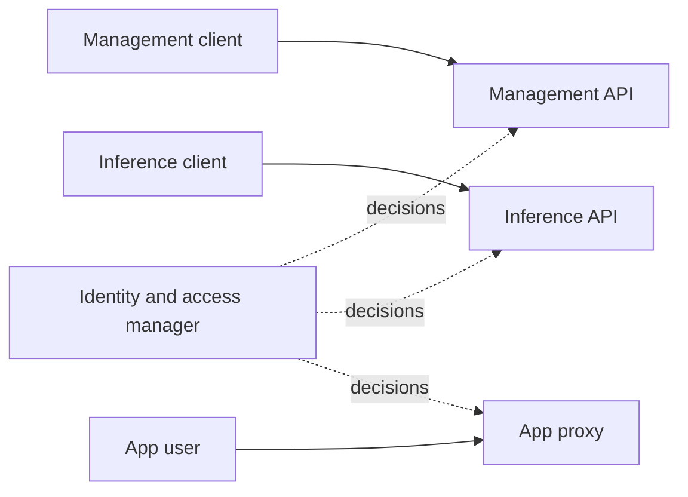

# Access

Who can do what, how machines trust each other, and what stays local.

## What you can do

- Use API keys for management and inference. Give people roles, sessions and sign-in through an
  identity provider.
- Keep everything local, or connect the site to Dotcore's services.
- See your entitlement and usage, and where each number comes from.

## How it works

Management, inference and app access are three separate entry points, and each checks its own
callers. The identity and access manager owns users, machine identities, roles, sessions, API keys
and access policy. It makes the decisions, and the entry points enforce them.

Each node has its own identity, issued by the site. A new node joins with a short-lived join token
and your approval. Removing a node revokes its identity. Nodes talk to each other over private
links for status, inference and diagnostics. A link needs a valid node identity and the exact peer
it expects.

The cloud connector is optional. It lets Dotcore's services manage the site remotely, and it owns
no state.

The metering and entitlement manager keeps entitlement policy and usage records on the site.

## Rules

- Access decisions are made on the site, even when an identity provider confirms who someone is.
- Local serving needs no Dotcore service, cloud or internet. Pulling an artifact needs its registry,
  and an upstream model needs its endpoint.
- Entitlement and usage tracking keep working when the cloud is down.
- The app proxy never trusts an identity the caller claims.
- Workloads get no platform credentials and no access to the control plane.
- Secrets are stored as references, never in plain text. Each component gets only the secrets it
  needs.
- Resetting a site replaces its trust. Old machine credentials stop working.
- The site only listens on its own recorded address unless you give it another one.

## Future

- Admin bootstrap, single sign-on, roles, scoped API keys and audit identity.
- Quotas, reservations and tenant isolation.
- Governance audit.
- Open: who holds secrets, how credentials rotate, and who can see diagnostics.
- Open: the cloud connector's transport, failover, and how you turn it off.
