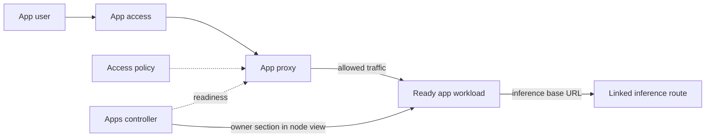

# Apps

An app deployment is one deployed catalog app, such as Open WebUI or n8n, running next to the
models. The apps controller owns app deployments. The app proxy lets users reach them.

Code: `backend/core/src/application/` (apps controller).

## Capabilities

- Discover approved catalog apps apart from their deployments.
- Deploy a configured catalog app on a target you choose, on a managed machine, and inspect its
  retained configuration.
- Set the app's typed parameters, basic or advanced, when you create a deployment.
- Link the app to an inference route when it declares that dependency, so it uses the site's models.
- Inspect its lifecycle, readiness, access information, resource use and workload diagnostics.
- Run GPU apps, such as ComfyUI, on Linux with NVIDIA GPUs: the app gets its target's GPUs, and you
  see which GPUs it has and its measured GPU memory. The app downloads its own checkpoints into app
  storage, which later deployments of the app on that machine reuse.
- Pause, resume and tear it down. Teardown stays available while paused.
- Keep app data that its deployments on one machine share, until disk cleanup finds it unused for a
  configurable number of days, or the site is reset.

## Architecture

### Reaching an app

- App access is the user-facing entry point, distinct from private workload endpoints.
- The proxy enforces identity and access decisions. It never trusts or forwards an identity the
  caller asserts.
- The proxy forwards allowed traffic only to workloads the controller reports ready.

### Linking a route

- An app links a route only when its immutable graph declares the matching input.
- The link keeps the route's stable identity, never a copied callable name, so renaming the route
  doesn't break it.
- Creating or launching an app never waits on route availability or enabled state. A linked route
  that's unknown fails that deployment, typed. Dotcore never substitutes another route.
- When a change keeps the route's identity but affects the app's launch, the controller reconciles
  the dependent launch.
- A retained app route link blocks deleting the route. Not every app links a route.

### Recording resource use

- The hosting node records each app service's CPU use, host memory and GPU memory as metric history.
  It attributes the runtime's resource observation of the deployment's group, and the node's GPU
  memory, on each hardware collection.

## Resources

### App deployment

What an app deployment keeps from creation:

- A stable node placement, one site-owned execution target identity, and its concrete platform with
  its configured GPU set.
- The exact, immutable launch identity of each service.
- The resolved typed parameters: catalog defaults, then operator overrides at creation, projected
  into service configuration.
- The inference base URL at which the hosting node reaches the manager, composed at creation.
- Its own published URL and a site-unique published host port, allocated at creation. The port
  belongs to the deployment, not to its snapshot or launch plan.
- Any optional route link.

### App storage

- Storage attachments are scoped to one deployment or to every deployment of the app on a node. The
  apps controller owns the attachments and their scope, never their content.
- App content belongs to you and the app.

## Components

### Apps controller

#### Responsibilities

- Own app deployment intent, placement, lifecycle, reconciliation, readiness, exposure policy and
  status.
- Own app configuration resolution and endpoint projection, including the site inference base URL
  and optional route links.
- Own typed app parameter resolution.
- Keep the target's GPU set in the snapshot at creation and pass that whole set to every unit at
  each launch.
- Before compiling any launch, recheck the kept GPU set against the target's current configured
  devices, and fail the deployment as incompatible when they differ.
- Prepare service images only for targets whose runtime backend needs them physically present.
- Project each unit's GPU memory, as attributed by the hosting node, from that node's current status
  at read time.

#### Boundaries

- On a virtualized runtime, readiness needs no probe. The deployment is ready once its group runs
  with an assigned endpoint, since nothing it runs serves.

### App proxy

#### Responsibilities

- Enforce app access policy and forward allowed traffic to controller-ready workloads.

#### Boundaries

- Holds derived serving state only: no deployment intent, status or authoritative readiness.
- Isn't the identity provider. The identity and access manager decides ([access](access.md)).

## Invariants

- A unit without current status or attribution reads its memory as unavailable with its reason, never
  a false zero.
- Storage shared across the app's deployments on a node outlives teardown, and is removed by machine
  cleanup once unused for its retention period, or by site reset.
- Administrator-supplied images stay distinct from verified catalog apps.

## Future direction

- Protected app access and explicit administrator custom images.
- Multiple approved apps with versions, configuration, updates, rollback, removal and app data
  policy.
- Staged updates and rollback under a mature version policy.

## Open decisions

- App access topology, identity forwarding and federation, provisioning and role mapping.
- App data retention, identity integration and lifecycle policy.
