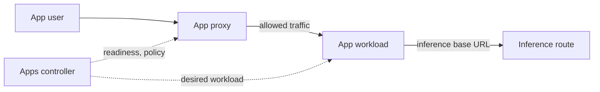

# Apps

An app deployment is one running copy of a catalog app, such as Open WebUI or n8n, next to the
models.

## What you can do

- Deploy a catalog app on a target you choose, and set its parameters (basic or advanced).
- Link it to an inference route, so it uses the site's models.
- Keep its data across restarts, and share data between its deployments on one machine.
- Open it through Dotcore's app access.
- See its status, readiness, logs, and CPU, RAM and VRAM use, now and over time.
- Pause, resume and tear it down.

## How it works

The apps controller owns app deployments: what you asked for, parameters, placement, lifecycle,
readiness, how the app is exposed, and its status.

Each app declares in the catalog what it needs to run: its services, artifacts, configuration,
storage, secrets, readiness checks and endpoints.

Users reach an app through the app proxy. The proxy checks access and forwards allowed traffic to
ready workloads. It only holds state it can rebuild from the controller.

A route link stores the route's identity, not its name, so renaming the route doesn't break it.
When the app is created, the controller sets two URLs: where the app reaches the site's models, and
where you reach the app.

The hosting node records each app service's CPU, host memory and GPU memory as metric history.
Memory that can't be tied to a service shows as unavailable.

## Rules

- An app can link to a route only if it declares that input.
- A missing route never stops an app from being created or started. If a linked route is gone, that
  deployment fails, and Dotcore doesn't pick another route.
- You can't delete a route while an app links to it.
- An app deployment keeps the exact GPUs of its target. If the target's GPUs change, the deployment
  fails as incompatible.
- Images an admin supplies are kept apart from verified catalog apps.
- Apps get no platform credentials, no access to the site store and no host privileges.

## Future

- App versions, staged updates, rollback and removal.
- Protected access to apps, with identity passed through to the app.
- Open: how long app data is kept, and how it's protected.
