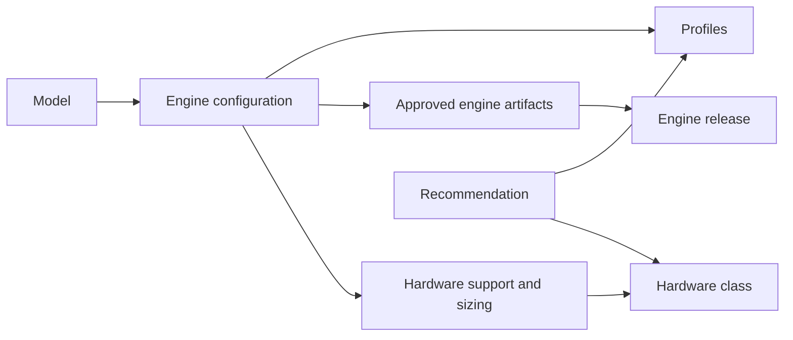

# Catalog

The catalog lists everything Dotcore can deploy: models, apps, engine releases, hardware classes,
upstream model templates, and the models it recommends.

## What you can do

- Browse models and apps, with their engines, supported hardware, score and licence.
- Pick a model profile, set total context, context per request and parallel requests, and see the
  values Dotcore works out from them.
- Get model recommendations for your use cases on your site's hardware.
- Add your own entries in a site or development catalog.

## How it works

The master catalog ships with Dotcore. A site or development catalog can add entries on top of it,
but can't replace master entries.

A model declares its maximum context, which comes from its weights. It has one engine
configuration per engine it runs on. That configuration is the model's launch recipe on that
engine: which engine artifacts are approved, which request kinds it serves, which hardware it
supports and how to size it. It can lower the maximum context.

Profiles are presets of defaults for a configuration. They hold no context values and name no
platform, so one profile works on every hardware class the configuration supports.

An engine release is one version of an engine, such as llama.cpp or vLLM, and the parameters it
exposes. Every release exposes the shared context parameters, with its own limits. Engine adapters
in the server turn those parameters into launch settings and decide when the engine is ready.

A hardware class is a kind of hardware. Its selector matches on platform and GPU facts, down to an
exact GPU model, and the most specific match wins. Sizing estimates memory for each hardware class
and fills in the launch values you leave out. The equations are linear in total context, which is
how Dotcore finds the largest context that fits.

Artifacts are pinned by image digest or Nix store path, so the same launch always gets the same
bits.

A use case is what you run models for: coding and agents, a general assistant, translation, or
decision making. For each hardware class and use case, the catalog gives a ranked list of model
profiles, some with a memory minimum. A site turns these into recommendations for each use case
across its targets, and keeps only the ones that fit.

## Rules

- Catalog entries never change once published. A deployment keeps what it resolved, and later
  catalog edits don't affect it.
- When two hardware class selectors overlap, one must contain the other, so there is always one
  most specific match.
- An engine that needs sizing only deploys when the catalog declares that sizing.
- Only the master catalog declares recommendations. Each one must run on its hardware class and
  serve its use case's request kind.
- A machine that stopped reporting still gets recommendations, based on its last readings and
  marked unreachable, until it leaves the site. No other read uses stale readings.
- Score, licence and recommendations are for display and advice. They never affect whether a
  deployment is accepted, where it runs, or whether it fits.
- Repository checks make sure the master catalog only points at Dotcore's own repository. Site and
  development catalogs can use any locked source.

## Future

- Custom model import: your own model sources, with checks on provenance, integrity, format and
  fit. No training.
- vLLM profiles that span several machines, where measurements justify them.
- Published qualification evidence for each supported profile.
- Open: app signing and supply-chain policy.
