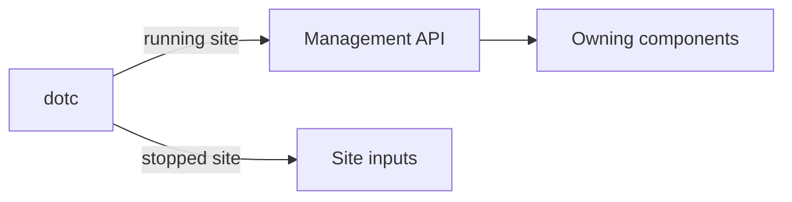

# CLI

`dotc` is Dotcore's command-line tool. Use it to set up a site, administer it locally, and script
changes.

## What you can do

- Set up and check a site before its server starts, then run the server.
- Add machines to a site, join a machine from that machine, and remove one.
- Inspect, pause, resume and tear down model and app deployments from scripts.
- Start a coding agent that uses one of the site's routes as its model.
- Run a one-off development workload, and free disk space that no deployment uses.

## How it works

When the site is running, the CLI talks to the management API, the same way the console does.
Before the server starts, setup commands write the site's input files instead. They never change a
running site.

Removing a machine and resetting a site both need the site stopped, and nothing else can run
while they do.

## Rules

- The CLI owns no state. The server accepts or rejects every change.
- Errors use the server's terms. The CLI adds the command that fixes the problem.

## Future

- Change a running site's configuration and node bindings, checked before the site reloads.
