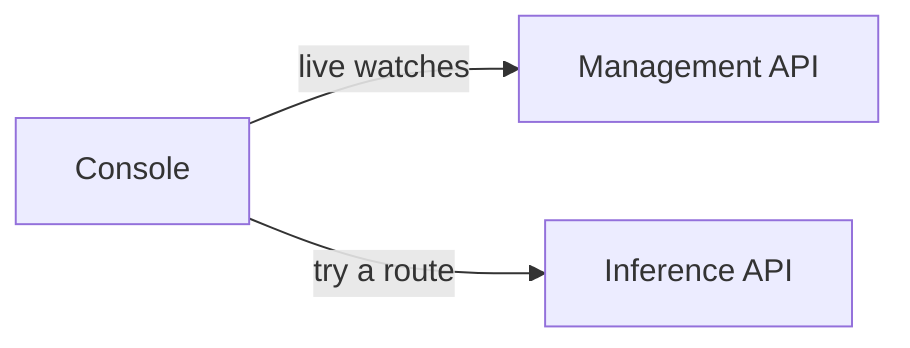

# Console

The console is Dotcore's web app for managing and watching a site.

## What you can do

- See and manage the site, its machines, deployments and routes.
- Start with a guided setup that recommends models for your use cases and hardware.
- Check whether a model fits a machine before you deploy it, and how much memory it would use.
- Look at metric history across machines, deployments and routes.
- Try a route: chat with a chat route, or ask a decision route typed questions.

## How it works

The console subscribes to the management API, so screens update as the site changes.

The chat is an ordinary inference client. Conversations last until you close the browser tab.
Decision drafts and saved questions stay in the browser.

## Rules

- The console owns no state.
- Memory fit, recommendations and resource figures all come from the server. The console has no
  fit or sizing logic of its own.
- Each figure comes from one source, so two screens never show different numbers.
- Sample data is always labeled.
- The chat has no tools, attachments or saved history.

## Future

- More administration: invitations, team membership, quotas and audit.
- Team views of capacity and consumption.
