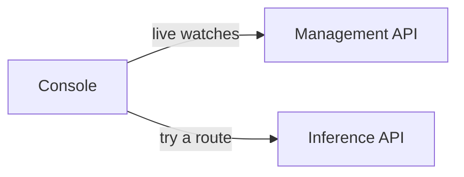

# Console

The console is Dotcore's web client, for graphical management and observation of a site. It is
also an inference client for trying routes.

Code: `frontend/` (its `AGENTS.md` holds the code map).

## Capabilities

- Manage and observe the site, its machines, deployments and routes, through the management API.
- See live updates as the site changes.
- Start with a guided quick start that recommends models for your use cases and hardware.
- Check fit and preview memory before deploying, from the server's capacity answers.
- Explore metric history across machines, devices, deployments and routes.
- Try inference routes: conversations with chat routes, and typed questions to decision routes
  through a form or the raw request.

## Architecture

### Watching the site

- The console subscribes to the management API's live watches ([README](README.md#managing-the-site)).

### Trying a route

- The chat is an ordinary inference client of the inference API.
- Conversations last for the browser session. Decision drafts and saved question sets are kept in
  browser storage.

## Components

### Console

#### Responsibilities

- Draw what the server answers: owner reads, capacity verdicts, previews, recommendations and
  metrics.
- Explain the impact of actions, confirm destructive ones, and show actionable failures
  ([README](README.md#principles)).

#### Boundaries

- Owns no product state.
- Holds no fit, headroom, sizing or starting-value rule ([machines](machines.md)). Each figure has
  one source, so two screens never disagree.
- Never shows representative or fixture data as infrastructure-backed.
- The chat has no assistant tools, console actions, attachments or saved history
  ([README](README.md#non-goals)).
- Not used for site initialization, node removal, destructive recovery, physical provisioning or
  installation ([cli](cli.md)).
