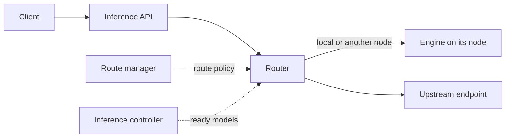

# Inference

An inference route is the name clients call. The router sends each request to a ready model in
that route.

## What you can do

- Call models by a stable route name, through OpenAI-compatible chat APIs and decision APIs.
- Put local and upstream models in the same route, with fallback in a set order.
- Rename, enable, disable and delete routes, and see why a route or model is down.
- See requests, latency and tokens over time, per route, deployment and site.
- Get connection details and integration examples for a route.

## How it works

The route manager owns route names, the models in each route, the policy and availability. It
never sees private endpoints or credentials.

The router picks a ready model from the route. It sends the request to that model's engine,
directly or through an authenticated call to another node, or to the upstream endpoint. It records
request metrics without slowing the request down.

There are two kinds of request. A chat request generates text. A decision request answers typed
questions with a probability for each option, from one pass of the model. Each public API format
is converted to one internal format per kind.

A model on a node only gets traffic while its node keeps reporting it as ready. If that report
goes stale, the model stops getting new requests. A short disconnect doesn't cancel requests
already running.

## Rules

- Clients call routes, never catalog models or deployments directly.
- A request only goes to models whose configuration supports its kind. If none does, the request
  is invalid. If none is ready, the route is unavailable.
- Fallback never switches models once output has started, never retries a deployment, and sends
  one request per upstream attempt.
- An invalid request never falls back.
- The route manager and the inference controller aren't on the request path.
- Request metrics are for operations, not billing.
- Connection details are guidance. They don't promise the endpoint is reachable.

## Future

- An Anthropic Messages-compatible endpoint on the same routes.
- Inference access tied to entitlement, and serving state that survives a restart.
- Batch inference: queued work with stored results, sharing machines with live traffic.
- Open: exposing routes outside the site.
- Open: routing to hosted, peer or third-party capacity beyond simple fallback.
