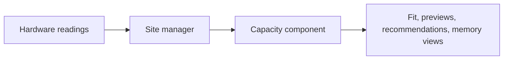

# Machines

This page covers a machine's hardware, the execution targets it offers, and whether a model fits in
its memory.

## What you can do

- See a machine's GPUs and memory, and which deployments use them.
- Check whether a model fits a target, and the largest total context that fits.
- Preview the memory a new deployment would use next to what already runs there.
- Describe a machine for development, and run a site on it without the real hardware.

## How it works

Dotcore describes hardware as data: the platform, host memory, and each GPU's memory and
architecture. Real machines, declared development machines and tests all use this same machine
description. Readings stay per GPU, so a machine can mix GPUs of different sizes. Each GPU is
either dedicated or shares the host's memory, as on a Mac.

An execution target is where workloads run on a node: one platform, an exact set of GPUs, and one
model or app runtime. Two targets on a node can share GPUs. Sharing doesn't reserve anything.

The capacity component answers memory questions. It holds no state of its own:

- It builds a memory pool for each dedicated GPU, and one host pool per node that unified GPUs
  share.
- It counts what each pool holds: the measured use of each deployment, other use, and claims. A
  claim is a starting model's estimate, counted until the model reports real use.
- It checks fit per pool against free memory minus some headroom, or against total memory when
  asked. A GPU pool's headroom is a small share of its total. A host pool keeps a reserve for the
  operating system and the host processes a starting workload adds, because unified GPU memory
  competes with them and can't be paged out.
- It gives the largest total context that fits, and the total context a new deployment starts with.

## Rules

- Fit is advice. It never blocks a deployment and never reserves memory.
- A missing fact gives an unknown answer, never a "no". A machine that stopped reporting keeps its
  totals, but fit against its free memory is unknown.
- A target is judged only on its own GPUs and its node's host memory.
- Readings from the GPU vendor's tools don't prove a target is ready or has room.
- Model recommendations, compatibility and memory views all get their answers from the capacity
  component.

## Future

- AMD GPUs on Linux, through ROCm engine builds.
- Placement controls, moves between machines, scheduling constraints, and automatic placement
  that uses the capacity component's answers.
- Models that span several machines.
- Finding new machines on the network, and moving workloads to replacement hardware.
- Open: whether placement ever enforces fit, and whether claims then become reservations.
- Open: how GPUs are shared between workloads.
- Open: which model and hardware combinations are supported, and what evidence qualifies them.
