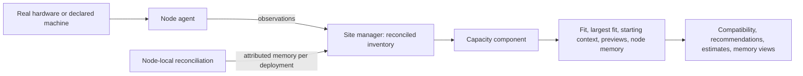

# Machines

A machine's hardware facts, the execution targets it offers, and whether a workload fits in its
memory. The site manager owns the reconciled hardware inventory. The capacity component turns it
into memory pools, occupancy and fit.

Code: `backend/node_hardware/` (hardware facts, signal sampling, declared machines),
`backend/core/src/hardware/` (attribution, capacity), `backend/nvml/`, `backend/host_process/`.

## Capabilities

- See configured machines, their hardware, GPU facts and resource use, with fleet summaries and
  per-machine detail.
- Discover the GPUs present on a machine, for every supported vendor, apart from how the site uses
  them.
- See which deployments use each GPU, when attribution is authoritative.
- Check whether a configuration fits a target for a scenario you choose (total context and
  optional context per request), against free memory by default or total memory on request.
- See the largest total context that fits a target's free memory, and start a new deployment's
  total context from it.
- Preview the memory a deployment would use on its target, beside what already runs there.
- Use machines with several GPUs of different sizes. Each target is judged on its own GPUs.
- Run development sites and tests on declared machines without their hardware. Real hardware only
  qualifies that a machine's readings match its description.

## Architecture

- Node agents observe hardware. The site manager reconciles those observations into an inventory,
  per node, device and target.
- Workload controllers attribute measured memory to their deployments on each hosting node.
- The capacity component evaluates the inventory and answers every memory question.

### From observations to an answer

- The site manager reconciles platform and GPU observations attributed to targets, each with an
  explicit freshness. Owner admission reads this inventory, never runtime, node agent or console
  snapshots directly.
- The capacity component reads each node's memory facts and the target-to-device mapping from that
  inventory and builds pools itself. It never reads node-local transport or runtime backends.
- The inference controller's compatibility read, model recommendations and resource estimates, and
  the site's memory views take their verdicts, previews and pools from the capacity component.
  Clients draw them and hold no fit, headroom or starting-value rule.

### Attributing memory to deployments

- Each workload controller's node-local reconciliation attributes its workloads' GPU memory from
  the hosting node's per-process observations, matched by the runtime's node-qualified process
  identity, or from the runtime's own process-memory report when it gives one. It reads them from the
  workload's first running observation.
- Every section of one node status attributes from the same hardware collection, runtime reports
  included.
- Both controllers apply one owner-neutral attribution scope that owns no product state, so the two
  never attribute the same hardware differently.
- Memory that can't be attributed reads as unavailable with its reason, never as a device-wide value
  or a false zero.

## Resources

### Machine description

Hardware as data: platform, host memory, and each GPU's memory and architecture. Real readings,
declared machines and tests all describe hardware in this one form.

### Declared machine

The description a node reports instead of its real hardware.

- A node observes either its real hardware or a declared machine, never both.
- It's resolved when the node is created, from GPU descriptions on a default simulated host or from
  a whole named machine, and kept with the node.
- The node reports it through the same observations as real readings, so reconciliation and
  capacity treat it like a real machine.

### Hardware observations

- Observations cover every production-supported GPU vendor on a node, independently of configured
  execution targets. They don't establish execution readiness or allocatable capacity, which the
  capacity component derives from them as memory pools and occupancy.
- An empty or unavailable vendor observation stays explicit, apart from absent hardware or an
  unhealthy machine.
- Each GPU states its memory architecture: dedicated memory, or unified allocation from the node's
  host memory.
- On unified nodes, host memory facts, including available memory, describe the shared memory. Host
  memory is never reported as GPU memory.
- Host available memory counts what the operating system can reclaim without displacing application
  memory, file cache included. Used memory is the total minus available.
- Each dedicated GPU reports its own total and used memory, with driver-reserved memory counted as
  used. GPUs of different sizes on one node stay distinct facts.
- The inventory keeps each node's memory facts on their own, for every GPU and the host, including
  host-only nodes and nodes without targets. It maps each target to its configured GPUs' facts and
  its node's host memory, from the same reading, so a target is judged by its own GPUs, never by
  another GPU on the node.
- Used and available memory are passing facts, never kept in a deployment snapshot.

### Execution target

Where workloads run on one node: one concrete supported platform, the exact GPUs its workloads
receive, and one typed model or app runtime binding.

- Configured devices name individual GPUs, and a workload uses the target's whole device set.
- Targets on one node may name overlapping GPUs, so a node can offer single-GPU and multi-GPU
  targets at once. Overlap and shared runtime infrastructure imply no reservation or exclusive
  ownership.
- Each target has a display name, unique among its node's targets and set when the node is declared.
  It's for presentation only, never an identity, placement or snapshot input.
- Platform validity depends on the runtime binding. Docker targets declare a Linux platform. Native
  targets declare the host platform, darwin/arm64 included.
- A target's platform, devices or runtime binding can't be removed, re-parented or altered while
  accepted deployment or cleanup intent references it, except when removing its node withdraws that
  intent.

### Memory pool

Memory a target draws from.

- One pool per dedicated GPU, and one host pool per node, shared by unified GPUs and host-memory
  estimates. A target draws from its own GPUs' pools and its node's host pool.

### Occupancy

What is in use in a pool.

- Measured use, attributed per deployment where controllers attribute it, other use, and claims.
- A starting local model deployment claims its resolved estimate until it's ready and measured, less
  the use already measured for it.
- App deployments occupy pools by the GPU memory attributed to them, in the host pool on unified
  GPUs. They carry no estimate and claim nothing.

### Demand

A resolved sizing estimate turned into bytes per pool on one target, so a launch across several GPUs
needs no new shape.

## Components

### Capacity component

#### Responsibilities

- Evaluate memory pools, occupancy, demands, fit, the largest fitting total context, the starting
  total context, target ranking and placement previews.
- Judge fit per pool against free memory (total less occupancy) less a headroom, or against the
  total on request. A GPU pool's headroom is a small share of its total. A host pool keeps a fixed
  reserve, capped on small hosts, for the operating system and the host processes a starting
  workload adds, because unified GPU memory competes with them and can't be paged out.
- Produce the placement preview a view draws for a target: each pool's occupancy with the new
  demand, the fit line and the starting total context.
- Produce the node memory projection that site memory views draw for each node: every pool with its
  occupancy, use past the total, and the deployments it can't size.

#### Boundaries

- Evaluates data only. Owns no product state and keeps nothing.
- Never reads node-local transport or runtime backends.

#### Interfaces

- Receive: the site manager's reconciled memory facts and target-to-device mapping, attributed
  occupancy, and resolved sizing estimates.
- Provide: verdicts, previews, largest fits and starting values to the inference controller, and the
  node memory projection to the management API.

## Invariants

- Fit is advice. Admission never blocks a deployment on fit, and a claim is never a reservation.
- Unknown facts give an unknown verdict. Stale facts keep only their totals, so free-memory verdicts
  and largest fits on them are unknown, never false.
- Vendor-wide observations are distinct from configured-device attribution, execution readiness,
  allocatable capacity and scheduling eligibility.
- Fleet summaries never infer per-GPU fit from total capacity.
- A future scheduler is the capacity component's named consumer. It uses the same inputs and rules:
  the reconciled inventory, with attributable identity and freshness.
  Runtime stays the final boundary for realizing a workload.

## Future direction

- Compatibility checks, placement controls, compatible placement and moves, scheduling constraints
  and automated placement.
- Models coordinated across several machines.
- Advanced GPU compatibility.
- Fleet extensions: discovering machines, migrating to replacement hardware, tenant isolation,
  reservations and hardware capability matrices.

## Open decisions

- Whether admission or a scheduler ever enforces fit, and how claims then become reservations.
- GPU sharing modes, interconnects and scheduling.
- Placement automation, quotas, reservations and tenant isolation policy.
