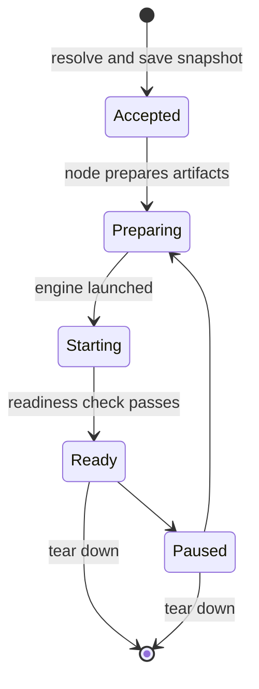

# Models

A model deployment is one running copy of a catalog model on one target, or a link to an upstream
endpoint.

## What you can do

- Deploy a model on a machine and target you choose, as many copies as you need.
- Override options and engine parameters, and see which values you set and which Dotcore worked
  out.
- See which targets can run each profile, and filter the catalog to models that fit.
- Pause, resume and tear down a deployment, and follow its progress, failures and logs.
- Add a model from any OpenAI-compatible endpoint, next to your local ones.

## How it works

The inference controller owns model deployments: what you asked for, the configuration, the
lifecycle, and whether a deployment may serve traffic.

When you deploy, the controller picks the engine artifact and hardware class for the target. It
then merges your values with the profile's defaults, the engine release's defaults and sizing, and
saves the result as the deployment's snapshot. Artifacts and hardware classes each have a selector
that matches the target's platform and hardware.

Every local deployment names one node and one of its targets. Dotcore never quietly falls back to
another machine, target, platform or artifact. The hosting node starts the model from the snapshot
alone, but the controller stays in charge.

An upstream deployment stores a template and a private endpoint. The site manager checks that the
endpoint works. It has no local engine and no placement.

The compatibility view shows which profiles each target can run. It goes through the same steps
as a real deployment, plus the capacity component's fit, and it's only advice.

## Rules

- Deploying never waits on memory fit. Dotcore only rejects a deployment that can't work, such as a
  target with the wrong number of GPUs.
- A snapshot never changes. New hardware or catalog changes apply only when you redeploy.
- Pausing keeps the deployment's identity, configuration and storage. It stops the workload and
  its traffic.
- Tearing down deletes the data that belongs only to that deployment.
- Memory use comes from the hosting node's current status. Without it, memory use shows as
  unavailable, never zero.
- Provider credentials stay private. Inference clients never see them, and connection details
  never include them.

## Future

- Safe model releases: compare evaluations, check provenance, roll out to a canary, promote, and
  roll back with the old version's capacity kept.
- Reviewable and exportable release evidence.
- Open: release thresholds, how long to keep rollback versions, and which roles can run disruptive
  operations.
