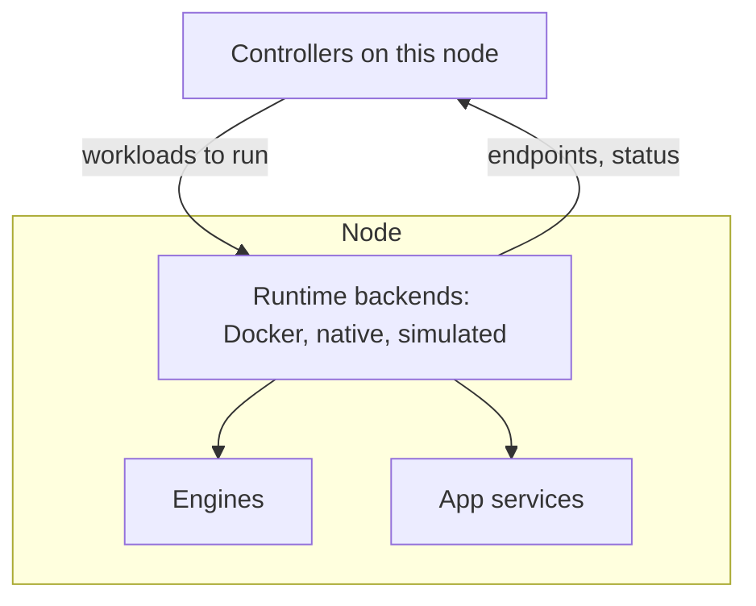

# Runtime

The runtime starts and stops workloads on one machine: model engines and app services, as
containers, native processes or simulations.

## What you can do

- Run on Linux with Docker and NVIDIA GPUs, or on a Mac with native engines and apps in Docker
  Desktop.
- Restart the Dotcore server without stopping native workloads.
- Run a development site on a described machine, without its hardware.

## How it works

A runtime backend runs workloads on its own machine, for one kind of target. The controllers don't
choose a backend. The server sets them up at startup.

Controllers hand the backend a launch plan that doesn't depend on the engine and uses placeholders
for paths, mounts and ports. The hosting node fills in the real values.

There are three backends:

- Docker runs workloads as containers on Linux targets.
- Native runs each workload as a host process, held by its own launcher so it survives a server
  restart.
- Simulated pretends to run workloads on a described machine, using their memory estimates. Memory
  readings and fit change as they would on the real machine. It never downloads engine artifacts.

Workloads ask for caches or app data by name. The backend sets the storage up and never hands out
host paths.

When asked, a backend reports a workload's CPU and memory use, or says it's unavailable.

## Rules

- Backends own no state. They don't decide placement, catalog entries or readiness.
- A backend never swaps in another artifact, platform, GPU or target, and never falls back to
  another backend.
- After a restart, backends find their workloads again from proof of ownership. If the proof is
  unclear, they leave the workload alone.
- Workloads are isolated by default. Any sharing is explicit and grants nothing else.
- Resource use is measured, never estimated, and backends keep no history of it.
- Inference requests and readiness checks don't go through the runtime.

## Future

- More runtime backends and GPU interconnects.
- Stronger isolation between workloads and the host.
