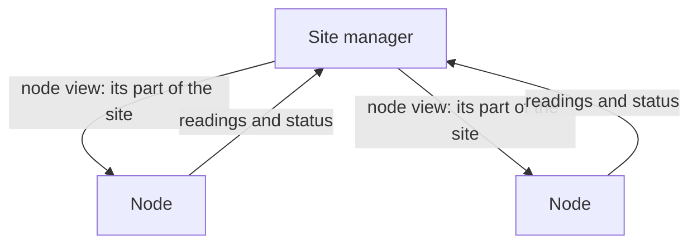

# Sites

A site is one Dotcore installation: one or more machines, called nodes, managed together.

## What you can do

- Create a site on one machine, then add or remove machines.
- See each node's health, role and connection.
- Reset a stopped site, which replaces the credentials its machines use to trust each other.

## How it works

The site manager is the authority for the site. It owns the site's identity, its member nodes, its
configuration, and the site-wide view of hardware and health. It runs on one of the nodes, and that
node runs workloads like the others.

The site configuration lists the site's machines, their execution targets and its settings. It's
written before the server starts. Each server process also gets a small local binding that tells it
which of those nodes it is. The binding can't add a node or change the site.

Each node gets a node view: just its own part of the site. The node starts and stops its workloads
to match that view. If one entry in the view is bad, only that deployment fails.

Each node keeps one authenticated connection to the site manager. Readings and status go up, and
node views come down. A node resends everything after it reconnects. Any message counts as a sign
of life, and idle nodes send heartbeats. A node that stays silent too long is marked unreachable.

Every reading carries the time the node took it, on that node's clock. Whether a reading is still
fresh is judged against that time, so a reader whose clock runs differently doesn't treat good
readings as stale.

A node agent on each machine reports its hardware and runs machine administration. It never touches
workloads.

## Rules

- Each kind of state has one owner, and each component writes only its own records.
- The site manager's memory is the authority. If saving to disk fails, Dotcore reports it rather
  than rolling the change back. Until the save succeeds, it won't take irreversible actions on other
  machines.
- Only the owner of a record changes it. Clients and remote services ask the owner.
- Creating a deployment together with its route is all-or-nothing. So is tearing down a deployment
  together with the routes that only it serves.
- Removing a node needs the site stopped. It removes that node's deployments and any routes that
  only they serve.
- The node that hosts the site manager gets no extra rights from it.
- Destructive cleanup needs exact proof of ownership. Without it, nothing is deleted.

## Future

- Drain a machine for maintenance, with a preview of what moves or stops, and protection against
  disruptive actions or ones the site has no room for.
- Signed Dotcore updates with rollback and recovery.
- During a cloud outage, keep serving and accounting locally, and mark remote views as stale.
- Open: high availability for the site manager.
- Open: which admin changes are safe while a node is disconnected, and how they're accepted when it
  reconnects.
