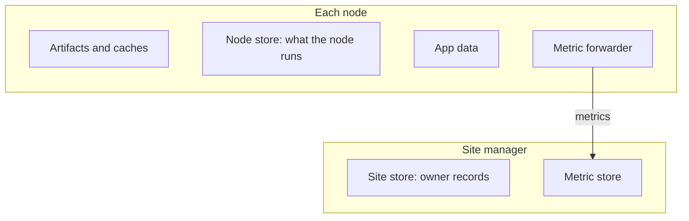

# Storage

What Dotcore stores, where, and who owns it: artifacts, caches, records, app data, backups,
metrics and logs.

## What you can do

- See what's downloaded and cached, and free disk space no deployment uses.
- Back up and restore a site.
- See metric history for machines, GPUs, deployments and routes on one timeline, with gaps where
  nothing was measured.
- Read workload and server logs, and get diagnostics when you need them.

## How it works

The artifact manager owns catalog entries and the artifact files. It pulls pinned images, builds
Nix artifacts for its own machine, checks them, and keeps them while deployments use them. During
development, a node can also build artifacts from its local source or image store.

The site store holds the site's durable records. Each component keeps its own records there, and
the store owns none of them.

Each node has a node store for state it can rebuild: what it runs, the exact launch details it
resolved, proof of what it owns for cleanup, and preparation logs.

Workload caches can be recreated, and each machine keeps them per site. App data belongs to you
and the app.

Each node sends metrics about itself through its forwarder to the site's metric store. Metrics are
stored in time buckets that line up across nodes. A reading stays valid for its sample interval
plus its reporting delay.

Logs and preparation output are read from the hosting node when you ask. They aren't collected
centrally.

Each node also keeps records of workload resource use, which are used to fit catalog sizing. You
can't query them and the console doesn't show them.

## Rules

- Where data is stored never changes who owns it.
- Artifacts stay available while a deployment uses them. Cleanup never removes anything a workload
  uses.
- Machine cleanup removes shared caches and app data that nothing has used for a set period.
- Recording metrics never slows down the work being measured. Metric history is for operations,
  not billing.
- Secrets and host paths are removed from diagnostics before they leave the node.
- Backups are copies, not the source of truth. They protect nothing until you set up what to back
  up.

## Future

- Local, network and object storage, through storage backends you configure.
- Artifact transfers between machines, cache visibility, cache size limits and automatic cleanup.
- Metrics export, and external time-series backends.
- Data visibility: what data exists, how much space it uses, how it's protected and how it
  relates. This is about seeing data, not data loss prevention.
- Open: what backups cover, and how fast recovery must be.
- Open: how long to keep telemetry, audit logs, workload resource records and batch results.
