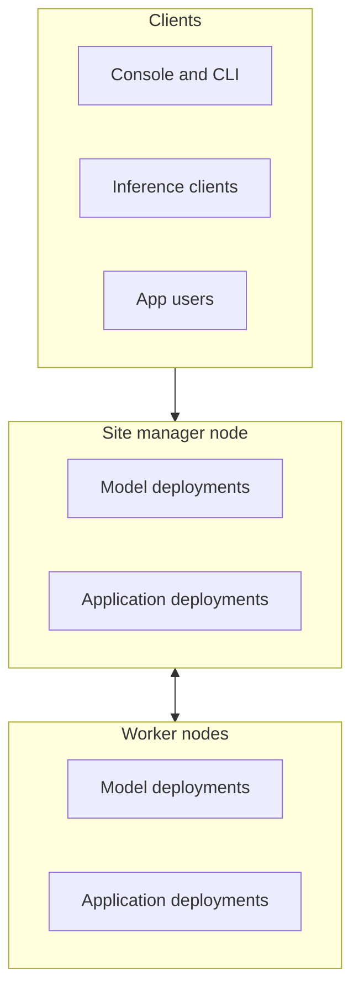
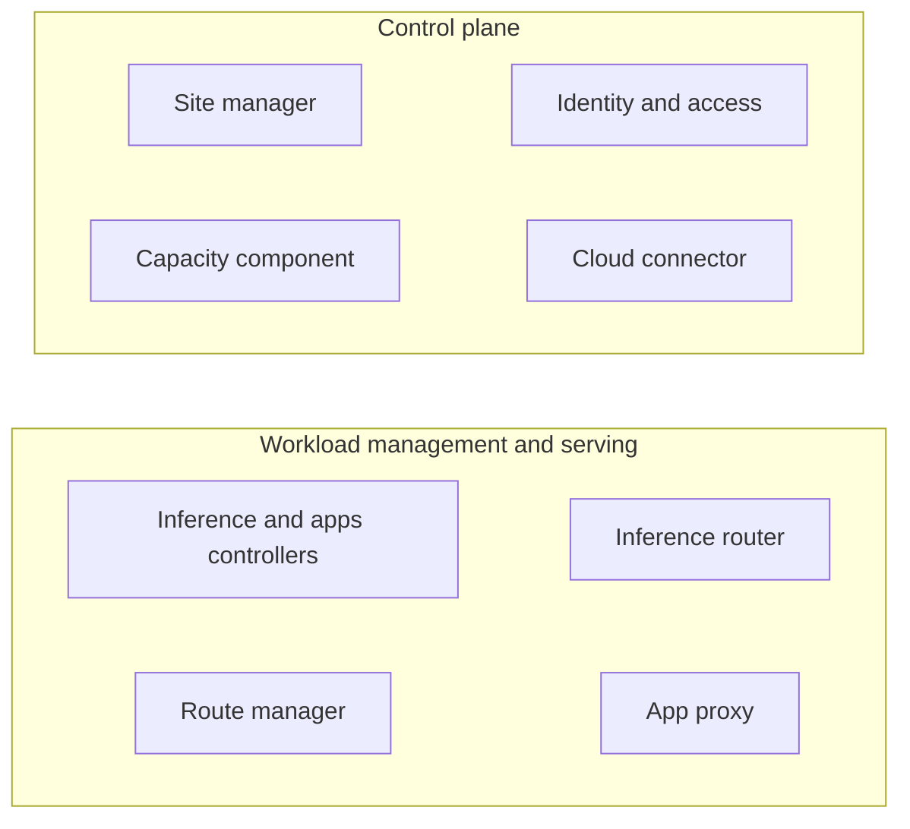
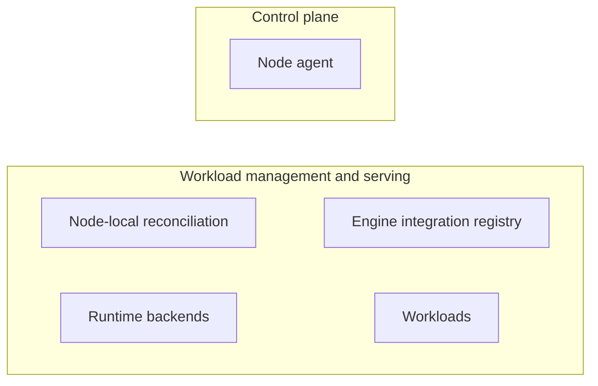
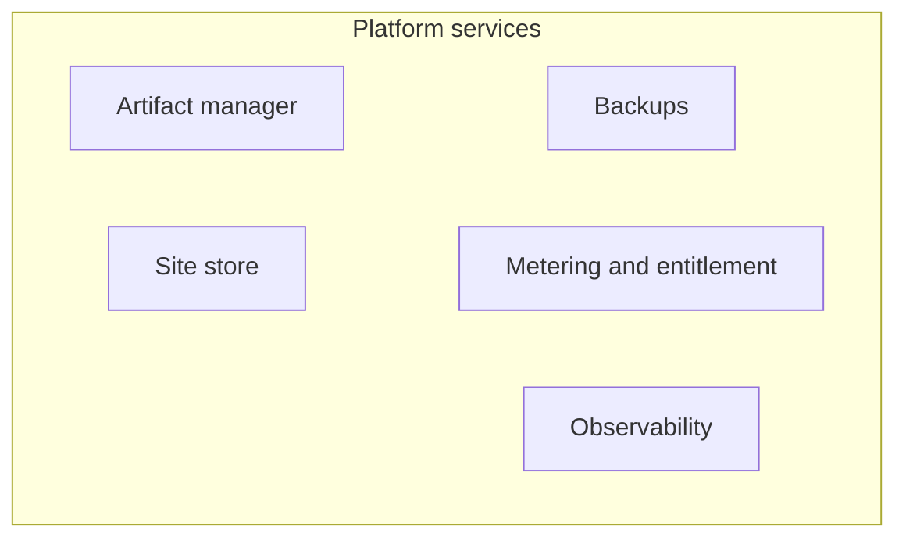
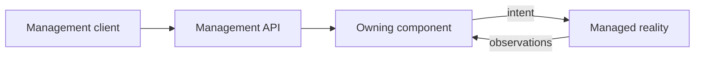

# Dotcore product and architecture

Dotcore runs AI models and approved apps on hardware you own, and manages them like a cloud. These
pages are the specs of the product's intent and its architecture. They describe the target design.

## Pages

Read this page first, then the page for the subject you work on. Terms from the
[repository glossary](../../AGENTS.md#glossary) are used without being defined again.

| Page | Subject | Owning components |
| --- | --- | --- |
| [Sites](sites.md) | A group of machines managed together, node membership, desired views, authority | Site manager, node agent |
| [Machines](machines.md) | Hardware facts, execution targets, memory pools and fit | Site manager (inventory), capacity component |
| [Catalog](catalog.md) | Models, engines, apps, hardware classes, sizing, recommendations | Artifact manager (declarations) |
| [Models](models.md) | Model deployments, local or upstream | Inference controller |
| [Apps](apps.md) | Application deployments and how users reach them | Apps controller, app proxy |
| [Runtime](runtime.md) | Starting and stopping workloads on one machine | Runtime backends, engine integration registry |
| [Inference](inference.md) | Routes and serving requests | Route manager, inference router |
| [Storage](storage.md) | Artifacts, records, node state, caches, metrics, logs, backups | Artifact manager, site store, node store, observability, backups manager |
| [Access](access.md) | Identity, machine trust, secrets, entitlement, cloud link | Identity and access manager, cloud connector, metering and entitlement manager |
| [CLI](cli.md) | `dotc`, the command-line client | (client) |
| [Console](console.md) | The web client | (client) |

## Architecture

- A site is one or more machines, each a node. One node, the site manager node, holds the site's
  authority and the entry points clients use. A site may have no worker nodes.
- Every node, the site manager node included, runs model and application deployments.
- Clients own no product state. The management API, the inference API and app access are separate
  entry points. They aren't extra components or required network hops.
- These are logical boundaries. Packaging, which process hosts a component, and where an adapter
  runs don't change them.
- [How it works](#how-it-works) zooms into each part.

## Users

- Platform admins look after infrastructure health, workload placement, capacity and maintenance.
- Model managers decide model configuration, quality and releases.
- Developers build products on served models and hosted apps.
- Team managers decide access and resource allocation.

People reach Dotcore through three clients: the console for graphical management and visibility,
the CLI for local administration and scripts, and the APIs for programmatic management, inference
and app access. Inference clients include SDKs, applications and evaluation harnesses.

## Principles

- Local autonomy. The site holds authority, and healthy local serving never depends on Dotcore's
  cloud ([access](access.md#invariants)).
- Desired intent, observed state, operations in progress and failures are always shown apart.
- Every value states its evidence: measured, estimated, representative, stale, unsupported or
  unavailable. A missing value is never shown as zero.
- Physical, reserved, used, claimed and available capacity are kept apart. Free memory in total is
  never proof that a workload fits.
- One capacity answer. Every view of memory fit, largest fit, starting total context and memory use
  shows the same server evaluation, so views never disagree.
- Actions explain their impact and constraints. Destructive actions ask for confirmation, and
  failures say what to do next.
- A change, including one from the cloud, is never shown as accepted until the site accepts it.
- Catalog items, deployments and routes each keep a stable identity. Names are for people and never
  replace identity.
- The console works with a keyboard, with visible focus, with reduced motion and on narrow screens.

## Non-goals

- Model training, fine-tuning and weight editing.
- A chat product beyond trying a route: persisted conversations, attachments, assistant tools,
  console actions, run history or route comparison.
- Physical provisioning and decommissioning, hardware replacement and GPU firmware tuning.
- Adopting or changing workloads Dotcore doesn't manage.
- Treating representative or sample data as measured infrastructure support.
- Treating private workload ports as a way for users to reach an app.
- Defining a verification process for third-party apps in these pages.
- Full administration workflows such as invitations, team membership and quota editing, and audit
  investigations are not designed yet.
- Agentic workloads, scheduling across sites, federation and a memory service are outside the
  architecture's scope. A site works with its own machines.

## Site shapes

- Single node. One machine may host site management, the node agent, the workload controllers,
  platform services, execution targets and workloads. The cloud connector is optional.
- Clustered site. One process, bound to the site manager node, holds the site's authority and its
  public management and inference entry points. Every node, that one included, may host execution
  targets and run node-local reconciliation ([sites](sites.md#site-manager-node)).
- Mac host. An Apple Silicon Mac runs Dotcore as a single node, or as the site manager or a worker
  of a clustered site. Models run on the native runtime and apps in Docker Desktop
  ([runtime](runtime.md)).
- Every Dotcore host requires Nix, which builds the Nix artifacts the host runs, including the
  loaders of Docker-delivered Nix artifacts.
- Co-locating or distributing components never moves their logical responsibility.

## How it works

Zoomed diagrams for the parts of a site, then the flows that cross them.

### On the site manager node

- The control plane administers sites and nodes ([sites](sites.md)), evaluates capacity
  ([machines](machines.md)), decides identity and access, and carries controlled remote management
  ([access](access.md)).
- Workload management and serving holds the controllers that own deployments ([models](models.md),
  [apps](apps.md)), route management and the serving components ([inference](inference.md),
  [apps](apps.md)).

### On every node

- The node agent reports the node's hardware ([sites](sites.md), [machines](machines.md)).
- Node-local reconciliation realizes the node's view for the workload controllers
  ([sites](sites.md)).
- Runtime backends start and stop workloads, and the engine integration registry checks and calls
  them ([runtime](runtime.md)).
- The node agent belongs to the control plane. The rest of the node's components and its workloads
  belong to workload management and serving.

### Platform services

- Platform services hold artifacts, durable records, backups, observability, entitlement and
  accounting ([storage](storage.md), [access](access.md)). Every other component uses them.

### Managing the site

A client asks the owning component for a change through the management API. The owner validates
it, accepts it, and drives reality toward it. Observations flow back to the owner.

- Owners validate and accept every change. Clients and remote services never write records
  directly.
- The management API exposes each owner's operations and reads. It isn't a product-state owner.
- It serves owner reads, and the capacity component's node memory projection, as live watches. Each
  change is stamped with the aligned interval it belongs to.
- Workload controllers reconcile their deployments continuously through the runtime backends and
  judge protocol readiness themselves. The site manager applies node intent through node agents,
  which doesn't imply continuous reconciliation.
- Dotcore never adopts workloads or execution targets it doesn't own
  ([runtime](runtime.md#invariants)).
- Every deployment, model or app, has an immutable identity that's never reused. Its display name
  can change and isn't unique. Its lifecycle generations are never reused.
- A paused deployment keeps its identity, configuration and storage, and releases its workload
  resources and serving eligibility. Teardown removes the deployment and deletes the storage placed
  with it alone.

### Deploying a model

1. You pick a model profile and a target, in the console or with the CLI.
2. The inference controller resolves the full configuration and saves it as the deployment's
   snapshot ([models](models.md)).
3. The site manager sends the hosting node its node view ([sites](sites.md)).
4. The hosting node prepares the artifacts ([storage](storage.md)) and its runtime backend starts
   the engine ([runtime](runtime.md)).
5. The node reports status. Once the deployment is ready, its routes can serve it
   ([inference](inference.md)).

### Serving a request

1. A client calls the inference API with a route name.
2. The router picks an eligible deployment in the route and invokes it on its hosting node, or calls
   its upstream endpoint ([inference](inference.md#serving-a-request)).
3. The answer streams back, and the router records request metrics.

## Future direction

Ideas that span several pages. Each page has its own.

- Capacity and consumption analytics: attribution, headroom, and what adding hardware would change.
  Enforcing allocations, procurement and automatic rebalancing are separate decisions.
- Data visibility: what data exists, what space it uses, how it's protected and how it relates.
  It covers visibility, not data loss prevention or general data management.
- Nix manages more of the host's software and dependencies.

## Open decisions

- Which safe administrative changes are allowed while disconnected from the cloud, and how they're
  accepted.
