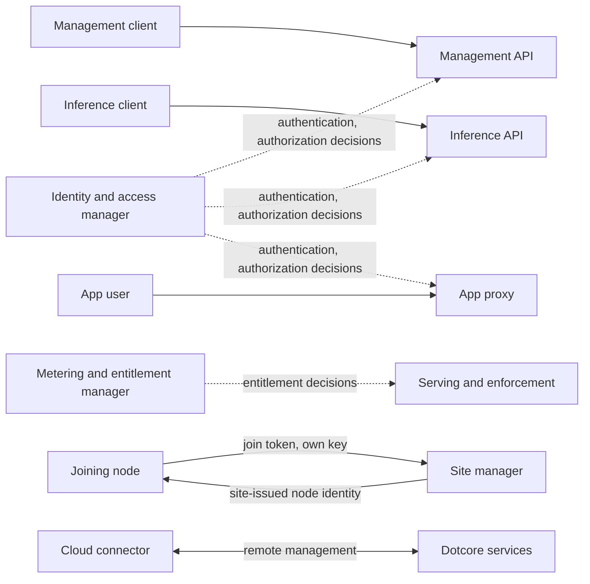
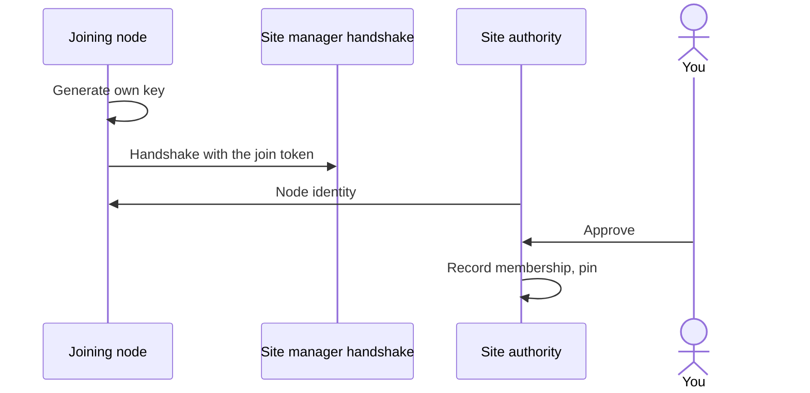
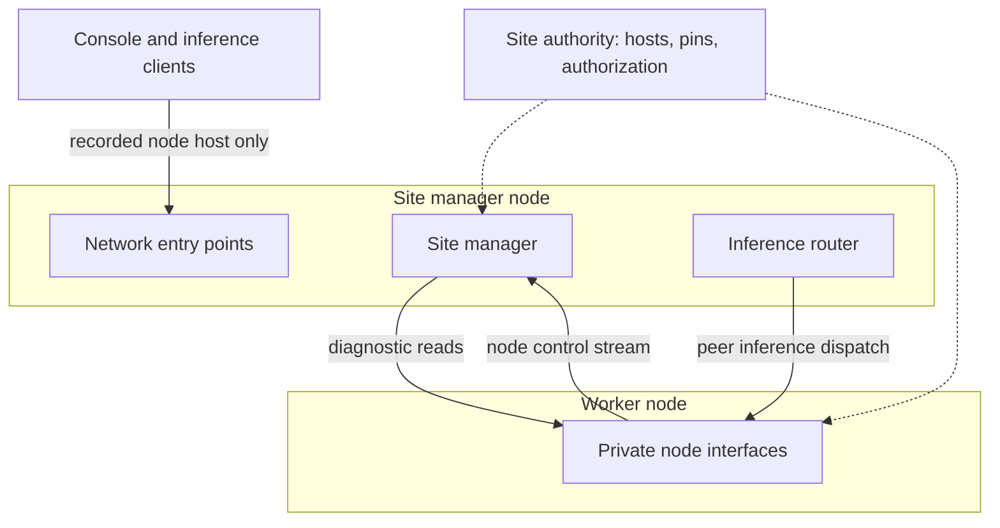

# Access

Who can do what, how machines trust each other, how secrets are held, and what stays local. The
identity and access manager owns identity and access policy. The cloud connector and the metering
and entitlement manager own the site's link to Dotcore's services and its local accounting.

Code: node identity and enrollment in `backend/site/`, listeners in `backend/core/src/server/`.

## Capabilities

- Keep management access, inference consumption and app access separate.
- See entitlement and usage, with where each number comes from and what enforces it.
- Join a machine to a site with your approval, and remove it.
- Keep the site fully local, or connect it to Dotcore's services for remote management.

## Architecture

### Joining a node

- Site machine trust is established before a worker enrolls. Each provisioned node, the site manager
  included, holds its own site-issued node identity. The site signing key is separate and held only
  by site authority.
- A node joins through a handshake hosted by the site manager. It generates its own key and
  authenticates the site and its manager with a short-lived, enrollment-only join token.
- Site authority issues the node's identity, then records its membership and pin only after you
  approve.
- Join tokens never authorize runtime traffic.
- Removing a node withdraws its membership and pin together. A removed node's identity no longer
  authenticates, even while its certificate is valid under the site's certificate authority.
- A node with an intact folder joins again by proving its pinned identity. Only its addresses change.

### Connecting nodes

- Private node connections need a valid site-local node identity, exact peer pins, and directional
  authorization derived from site authority and trusted bootstrap policy, not a manager-specific
  certificate type. This holds even when the site has no workers.
- The node control stream, peer inference dispatch, and deployment and backend diagnostic reads are
  authenticated private interfaces, not public node entry points. No remote caller may present the
  receiving node's identity.
- Site authority records, per node, the host (IP address or DNS name) the manager reaches it at, and
  the host it reaches the manager at. The node using a host resolves it, including on behalf of its
  workloads. Peer authentication depends on neither the dialed address nor addresses in
  certificates.
- The site manager's network entry points (console and inference) listen by default only on its
  recorded node host, never on every interface. Listening elsewhere takes an address the operator
  names.
- Site reset rotates trust, so previously issued worker credentials can't authenticate with the new
  manager.

## Resources

### Identities and policy

- Users, machine identities, roles, permissions, sessions, API keys, identity provider configuration
  and access policy, all owned by the identity and access manager.

### Secrets

- Stored as references, never as durable plaintext values.
- Verification and serving each receive only the credential capability they need.
- Private provider credentials stay apart from inference client credentials and public connection
  information.

### Entitlement and usage

- Local entitlement policy and durable usage and request accounting records, owned by the metering
  and entitlement manager.

## Components

### Identity and access manager

#### Responsibilities

- Own identities, roles, permissions, sessions, API keys, identity provider configuration and access
  policy.
- Supply authentication and authorization decisions to the components that enforce them.

#### Boundaries

- Isn't a traffic proxy. The entry points and the app proxy enforce its decisions.

### Cloud connector

#### Responsibilities

- Provide controlled remote-management connectivity between the site and Dotcore's services.

#### Boundaries

- Owns no product state and never overrides local owners.

### Metering and entitlement manager

#### Responsibilities

- Own local entitlement policy and durable usage and request accounting records.

#### Boundaries

- Serving and enforcement consume its decisions without owning policy or accounting state.

## Invariants

- The site's owners keep authority over configuration, workload intent, access policy, readiness and
  locally retained state.
- Healthy local serving and deployed apps continue without Dotcore's services, cloud management or the public
  internet. Acquiring an artifact may need its registry, establishing an external identity may need
  its identity provider, and upstream inference needs its endpoint.
- Upstream locality, trust domain and data egress are explicit.
- Authorization stays local, even when an external identity provider establishes identity.
- Hosted workloads get no platform credentials, site store access, control-plane interfaces or host
  runtime privileges. Purpose-scoped workload credentials and permitted workload communication grant
  no platform authority.
- Holding secrets never transfers product authority or adds a cloud dependency for local serving.
- Local entitlement decisions and durable usage accounting continue during cloud outages.
  Synchronization and settlement are separate concerns.

## Future direction

- API keys enforced for inference and management access.
- Local administrator bootstrap, single sign-on, role-based access, sessions, scoped keys,
  machine-local secrets and audit identity.
- Team and identity operations, with visibility into team capacity and consumption.
- Local entitlement state and minimum durable usage and request accounting.
- Customer-approved remote-access boundaries.

## Open decisions

- Secret custody, credential lifecycle and protected diagnostic access.
- Identity provider selection, usage synchronization, billing, settlement and export.
- Cloud connector transport, connectivity policy, disablement and failover.
- Roles allowed to run disruptive operations, and later administration workflows.
