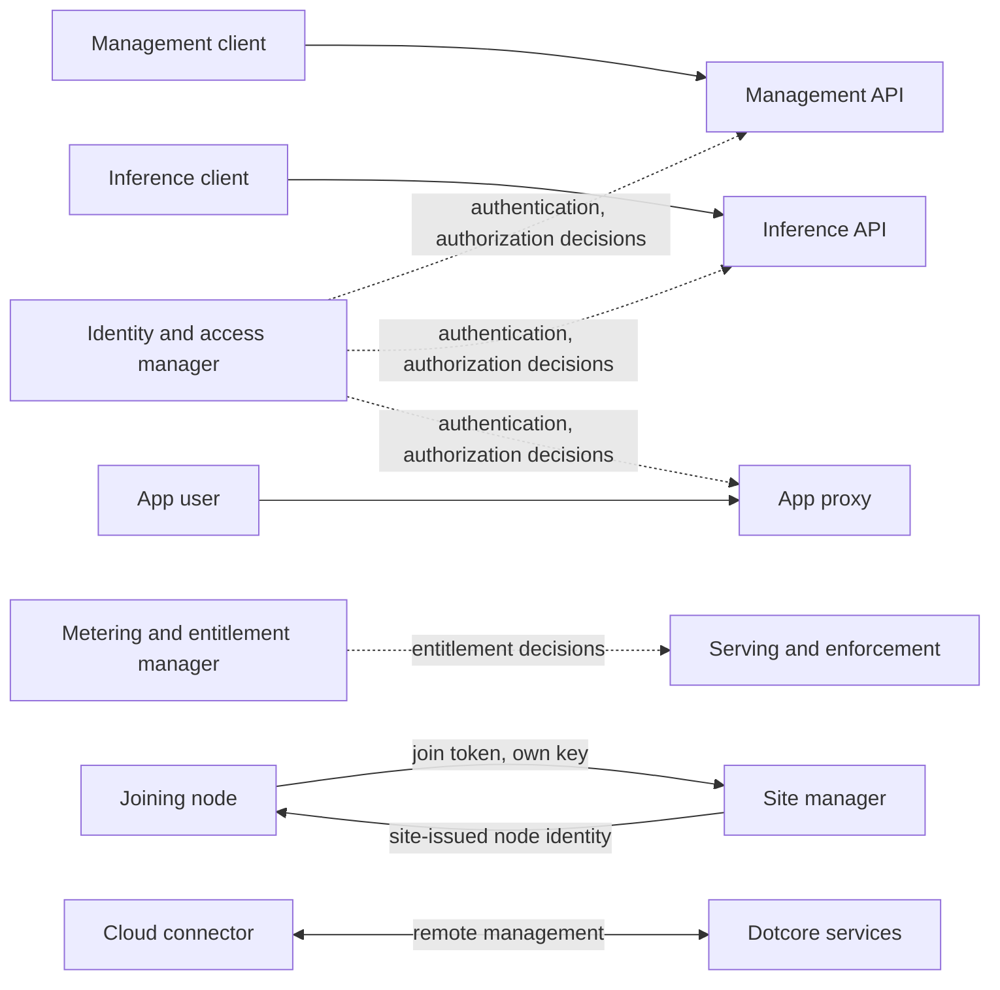
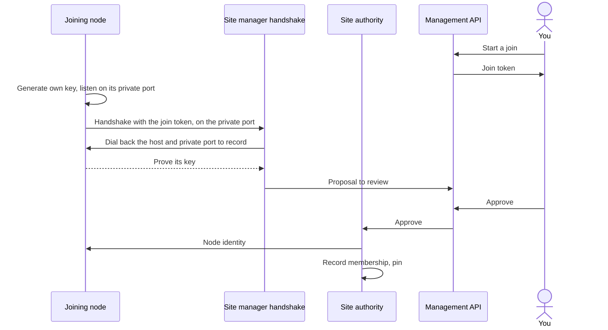
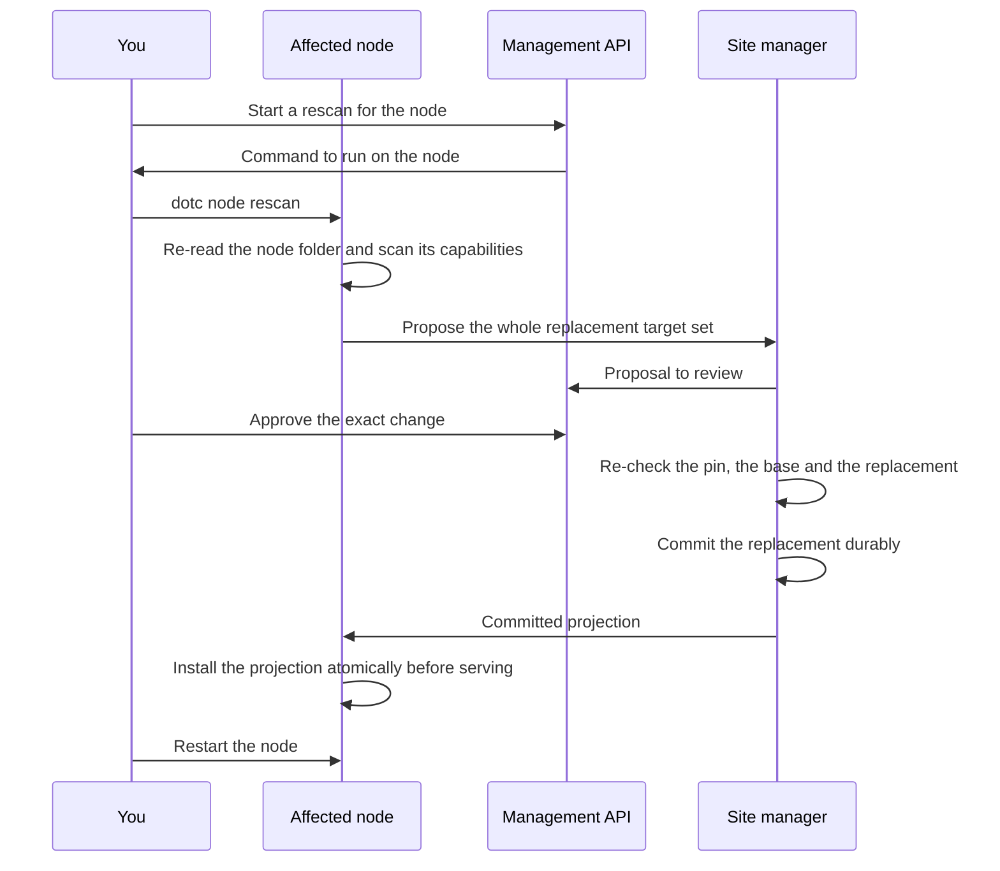
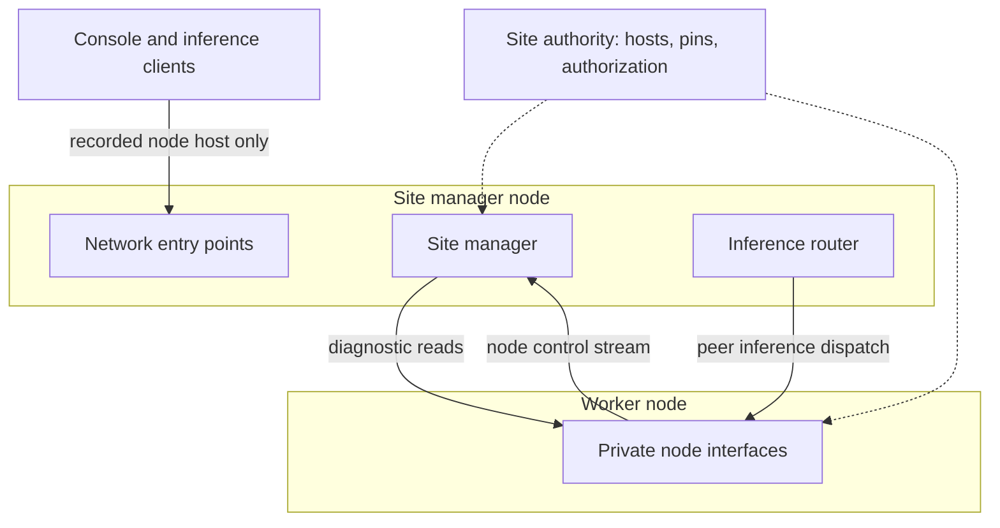

# Access

Who can do what, how machines trust each other, how secrets are held, and what stays local. The
identity and access manager owns identity and access policy. The cloud connector and the metering
and entitlement manager own the site's link to Dotcore's services and its local accounting.

Code: node identity and enrollment in `backend/site/`, listeners in `backend/core/src/server/`.

## Capabilities

- Keep management access, inference consumption and app access separate.
- See entitlement and usage, with where each number comes from and what enforces it.
- Join a machine to a site with your approval, and remove it.
- Re-scan an existing machine and replace its complete target set with your approval, keeping its
  identity, trust, addresses, deployments and routes
  ([re-scanning a node's targets](#re-scanning-a-nodes-targets)).
- Keep the site fully local, or connect it to Dotcore's services for remote management.

## Architecture

- The identity and access manager owns identities, roles, sessions and access policy. It gives the
  entry points and the app proxy their authentication and authorization decisions.
- The metering and entitlement manager owns local entitlement policy and usage and request
  accounting. Serving and enforcement consume its decisions.
- The cloud connector provides controlled remote-management connectivity to Dotcore's services. It
  owns no product state and never overrides local owners.
- The site manager issues a joining node's identity ([sites](sites.md)).

### Joining a node

- Site machine trust is established before a worker enrolls. Each provisioned node, the site manager
  included, holds its own site-issued node identity. The site signing key is separate and held only
  by the site manager.
- A node joins a running site through a handshake hosted by the site manager on its private port,
  with no extra port to open. You start the join from the console or `dotc`, which return the join
  token. The node generates its own key and authenticates the site and its site manager with that
  short-lived, enrollment-only join token.
- The private port accepts connections without a site identity for the join handshake only, since
  the joining node has none yet. Only the site manager's port accepts them. Their requests reach
  nothing else and are refused when no join is active. They are limited in number, and closed when
  they go too long without a join request, whatever else they send. A wrong join secret closes its
  connection and counts against no join.
- Before you approve, the site manager dials back the host and private port the join will record
  and requires the answer to prove the joining node's key. If it cannot reach the node there, or
  another key answers, the join fails with nothing issued or recorded. A node behind NAT must have
  that port forwarded while it joins. The token allows a few failed dial-backs, so a corrected
  retry works.
- The site manager issues the node's identity only after you approve through the management API,
  from the console or `dotc`, after seeing the node's name, host and targets. The approver and
  the joining machine show the same key fingerprint and fingerprint pattern, so you can match them
  before approving. A rejected or failed join records nothing and leaves the token usable for a
  corrected retry.
- Membership is persist-or-reject: the site manager signs the node's identity into the offer it
  sends after approval, but trusts the node's pin and confirms its commit only once the pin and
  membership are recorded durably. The new node's connections are then accepted without a restart.
  If recording fails, the join fails, nothing is recorded, and the node's identity is never
  trusted.
- Join tokens never authorize runtime traffic.
- Removing a node withdraws its membership and pin together. A removed node's identity no longer
  authenticates, even while its certificate is valid under the site's certificate authority. On a
  running site, the site manager trusts the node's pin until the removal is recorded durably, then
  closes the node's open connections at once and tells the node, when it connects again, that it
  is no longer a member.
- A removed node can't join again with its folder. You clean the machine, then join it with a new
  token.
- A node with an intact folder joins a running site again by proving its pinned identity. Only its addresses change, and the dial-back checks the new ones the same way.
- Joining never carries a target. One node's target set is changed only by a rescan ([re-scanning a node's targets](#re-scanning-a-nodes-targets)), a separate, explicit operation that keeps the node's identity, trust and addresses.

### Re-scanning a node's targets

The one `dotc node rescan` command serves both paths. The command runs on the affected node and
scans its own capabilities; the manager never scans a remote node. Ordinary `dotc node join` is
unchanged: a rejoin carries addresses and trust only, and never a target; a new node's join still proposes its initial targets.

- Worker path: the command re-reads and re-validates the node folder under custody, scans locally
  and proposes the whole replacement target set with the refreshed observation configuration to the
  manager. The manager verifies the node's pinned identity, derives the base itself from durable
  state, classifies added/changed/removed/unchanged targets, refuses the whole change when
  removing or changing a target with a deployment, including one pending teardown, and validates
  the whole site. The operator reviews the exact node, the classification, the deployments
  affected and the restart instruction, and approves once. The manager commits the whole
  replacement durably before the node installs it. The worker installs the committed projection —
  the whole target set, the refreshed observation configuration and its canonical digest — atomically
  (temporary file plus rename) and validates it before the node serves. A no-op installs nothing and
  needs no restart.
- Manager path: the command runs locally on the manager node; the operator reviews and confirms
  the change in the terminal. The manager applies the same replacement through the authoritative
  live-site path — no join, no new RPC, no automatic restart — re-checks the approval-relevant state at
  commit, commits the replacement durably, then reports the required restart.
- On both paths the affected node restarts before it serves under the replacement. The command
  instructs the operator to restart after a durable commit (and, on the worker path, a successful
  install). No automatic restart or generic live reload in this pass. A no-op writes no bytes and
  needs no restart.
- The approval is bound to the pin, the whole-node base and the exact replacement. The manager
  re-checks all three at commit; a stale base, a mismatch or a wrong pin fails closed and records
  nothing. Replay identity is the whole-node base plus the exact replacement — never a separate
  replay token. An identical committed replacement replays once: the manager returns the prior
  durable outcome. A lost acknowledgement fails closed, then compares the durable node declaration;
  the operation is never rolled back merely because the acknowledgement was lost.
- Scan scope: the node looks for every capability its host offers, not only the ones it declares,
  so a capability gained since it was declared, such as Docker on a Mac set up without it, adds its
  targets. A declared capability the host no longer offers keeps its committed targets, which report
  unavailable; the scan never removes them. A kind of workload the node runs simulated stays
  simulated: the scan adds no real capability of that kind beside it.
  A capability that is present but unusable, such as a Docker daemon that fails to answer, is
  reported to the operator with its reason; an absent one is silent.
- One rescan at a time answers a node: starting a new rescan for the node forgets its ended
  rescans, and only the new invitation answers the node. A node that lost its answer proposes again
  under the new invitation and goes to review; the durable declaration decides the outcome.
- Classification: the same node and target identity with the full declaration equal is unchanged;
  the same identity with a declaration difference is changed; differing identity is added or removed.
- The whole projection — targets, the refreshed observation configuration and the bootstrap digest —
  is equal for a no-op, enforced at write time: the worker never writes or installs when the
  projection differs nothing.
- Retained publication host: a Docker app target that cannot be reached stays declared, keeps its
  recorded host and endpoint configuration, and reports unavailable. The outage blocks neither
  native model serving nor its fence, and never blocks the restart; fail-closed behavior is reserved
  for structurally invalid or stale proposals, never for a live outage.
- The console reuses the existing machines/approval surface — it shows the exact node, the
  classification, the deployments affected and the restart instruction — while the command runs in
  a terminal on the affected node. No console is added to worker nodes.
- One host contract: a new node still uses the ordinary join flow; both worker and manager
  rescans go through the one rescan contract above — the manager's private listener for a worker,
  the authoritative live-site path on the manager node.

### Connecting nodes

- Private node connections need a valid site-local node identity, exact peer pins, and directional
  authorization derived from the site's authority and trusted bootstrap policy, not a
  site-manager-specific certificate type. This holds even when the site has no workers. The one
  exception is the join handshake, which accepts a node that has no identity yet and checks its join
  token instead ([joining a node](#joining-a-node)).
- The node control stream, peer inference dispatch, and deployment and backend diagnostic reads are
  authenticated private interfaces, not public node entry points. No remote caller may present the
  receiving node's identity.
- The site manager records, per node, the host (IP address or DNS name) the site manager reaches it
  at, and the host it reaches the site manager at. The node using a host resolves it, including on
  behalf of its workloads. Peer authentication depends on neither the dialed address nor addresses
  in certificates.
- The site manager's network entry points (console and inference) listen by default only on its
  recorded node host, never on every interface. Listening elsewhere takes an address the operator
  names.
- Site reset rotates trust, so previously issued worker credentials can't authenticate with the new
  site manager.

## Resources

### Identities and policy

- Users, machine identities, roles, permissions, sessions, API keys, identity provider configuration
  and access policy, all owned by the identity and access manager.
- Per-user preferences, such as how one person's console looks, wait for this manager. Until then,
  console settings are site-wide, not per user, and the site manager owns them
  ([sites](sites.md#site-manager)).

### Secrets

- Platform and provider credentials are stored as references, never as durable plaintext values.
- A deployment's secret parameters, such as an app login or an engine key, belong to that
  deployment. Its controller generates or accepts them at creation, keeps them with the
  deployment, and gives each workload only the value or derived form it needs.
- Clients show secret parameters masked until asked. Logs, diagnostics and telemetry never carry
  them.
- Verification and serving each receive only the credential capability they need.
- Private provider credentials stay apart from inference client credentials and public connection
  information.

### Entitlement and usage

- Local entitlement policy and durable usage and request accounting records, owned by the metering
  and entitlement manager.

## Components

### Identity and access manager

#### Responsibilities

- Own identities, roles, permissions, sessions, API keys, identity provider configuration and access
  policy.
- Supply authentication and authorization decisions to the components that enforce them.

#### Boundaries

- Isn't a traffic proxy. The entry points and the app proxy enforce its decisions.

### Cloud connector

#### Responsibilities

- Provide controlled remote-management connectivity between the site and Dotcore's services.

#### Boundaries

- Owns no product state and never overrides local owners.

### Metering and entitlement manager

#### Responsibilities

- Own local entitlement policy and durable usage and request accounting records.

#### Boundaries

- Serving and enforcement consume its decisions without owning policy or accounting state.

## Invariants

- The site's owners keep authority over configuration, workload intent, access policy, readiness and
  locally retained state.
- Healthy local serving and deployed apps continue without Dotcore's services, cloud management or
  the public internet. Acquiring an artifact may need its registry, establishing an external
  identity may need its identity provider, and upstream inference needs its endpoint.
- Upstream locality, trust domain and data egress are explicit.
- Authorization stays local, even when an external identity provider establishes identity.
- Purpose-scoped workload credentials and permitted workload communication grant no platform
  authority. What hosted workloads never get is in [runtime](runtime.md#workloads).
- Holding secrets never transfers product authority or adds a cloud dependency for local serving.
- Local entitlement decisions, durable usage accounting, reconciliation and telemetry continue
  during cloud outages. Synchronization and settlement are separate concerns.

## Future direction

- Local administrator bootstrap, single sign-on, scoped keys, machine-local secrets and audit
  identity.
- Team and identity operations, with visibility into team capacity and consumption.
- Customer-approved remote-access boundaries.

## Open decisions

- Secret custody, credential lifecycle and protected diagnostic access.
- Identity provider selection, usage synchronization, billing, settlement and export.
- Cloud connector transport, connectivity policy, disablement and failover.
- Roles allowed to run disruptive operations, and later administration workflows.
- Management access has no authentication yet, so whoever reaches it can start and approve joins.
