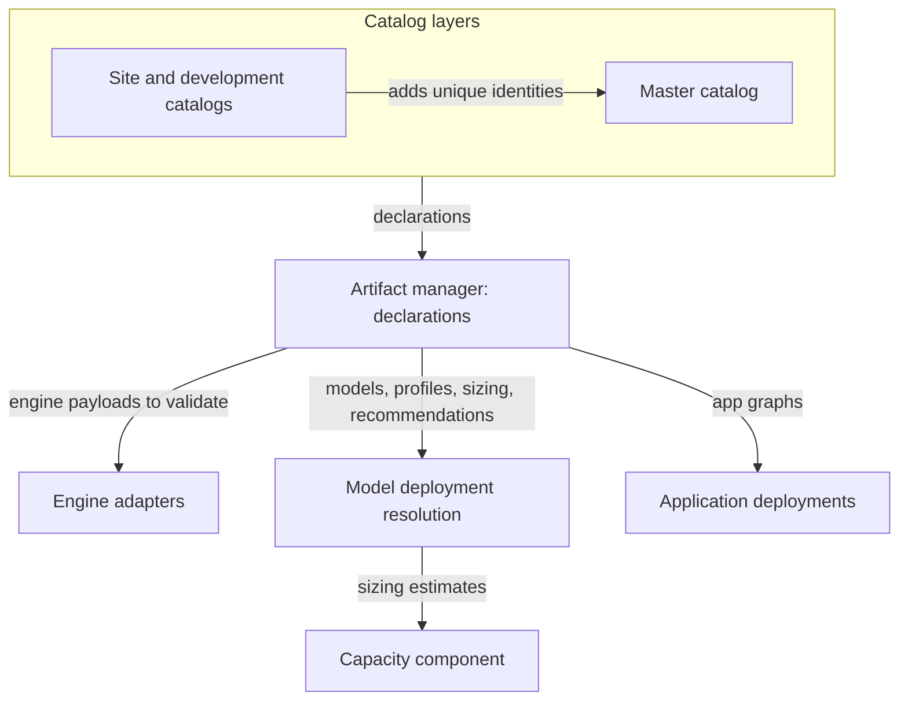
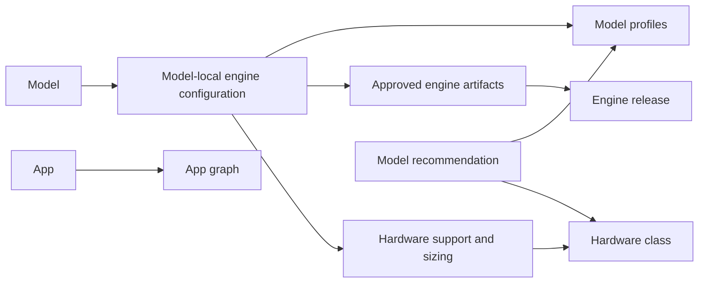
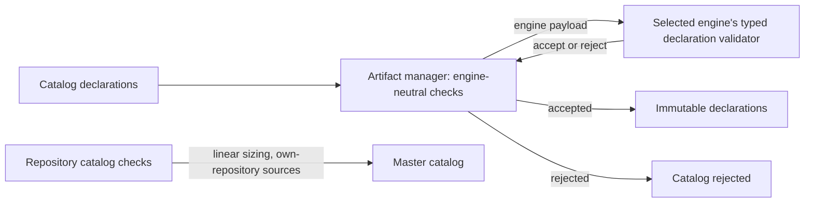

# Catalog

The catalog holds the immutable declarations Dotcore can deploy: models, apps, engine releases,
hardware classes, upstream model templates and model recommendations. The artifact manager owns the
declarations and their lifecycle. Engine adapters own what engine-specific payloads mean.

Code: `backend/catalog/` (declarations, validation, sizing), `catalog/` (the master catalog).

## Capabilities

- Discover catalog models with their compatible profiles, artifacts, capabilities and launch
  requirements.
- Serve local models through catalog-selected llama.cpp and vLLM profiles. You pick a profile, not
  an engine build.
- Tell models you can discover or acquire from models you can deploy.
- Set the same context parameters on every engine: total context, context per request and parallel
  requests, with engine defaults.
- See catalog estimates per hardware class for a scenario you choose.
- Compare models by the Dotcore Bench Intelligence Score, and see each model's upstream licence with
  a link to its terms.
- Add your own entries through a site or development catalog.

## Architecture

- The artifact manager owns the immutable catalog declarations of the master, site and development
  catalogs ([storage](storage.md)).
- Engine adapters validate each engine's payloads. The artifact manager never interprets them
  ([runtime](runtime.md)).
- Model deployment resolution builds a deployment's configuration from the declarations and sends
  sizing estimates to the capacity component ([models](models.md), [machines](machines.md)).
- Apps take their service graphs from the declarations ([apps](apps.md)).

- A model has one model-local engine configuration per engine it runs on: its launch recipe there.
- An engine release declares one version of an engine and the parameters it exposes. Engine
  artifacts are its runnable builds.
- A hardware class names a kind of hardware. Hardware support holds a configuration's memory
  minimums and sizing constants for one class.
- An app declares a graph of services and requirements.

### Validating a catalog

The artifact manager validates engine-neutral structure, including hardware class references, and
calls the selected engine's typed declaration validator. It never interprets engine payloads or
option effects itself.

- Option kinds may fix engine-neutral parameter shapes and constraints across options. Engine
  adapters own their effects.
- Selectors that overlap without strict nesting are rejected, among one configuration's approved
  engine artifacts and among its supported hardware classes.
- Engine releases that share a parameter schema identity must declare identical parameter
  definitions.
- A configuration may not approve artifacts from releases of different engines or different
  parameter schemas.
- A configuration whose engine requires sizing is rejected when a binding lacks a footprint
  estimate for a supported hardware class, or a derivation for an engine parameter that a profile
  omits and the engine release doesn't default.
- Sizing equations must be linear in the total context, so the largest fitting total context follows
  from the estimates.
- Repository checks reject a non-empty literal bound to a credential-like variable name in the
  master catalog; such values come from secret parameters.
- Repository checks keep the master catalog pointing only at Dotcore's own repository. The backend
  accepts any locked source in site and development catalogs.

## Resources

### Catalog layers

- The master catalog is the platform's own. Site and development catalogs may add unique
  identities, but never shadow or change master records.

### Model

- Declares a maximum context, a property of its weights. A model-local engine configuration may
  declare a lower one when its engine can't serve the model's. Resolution enforces the lower of the
  two at deploy time. Engine limits stay separate, as engine parameter bounds.
- May carry an intelligence score and the upstream licence with a link to its terms. Both are display
  metadata, outside the model's release identity and deployment snapshots. The licence is not a
  compliance assessment.

### Model-local engine configuration

- Names its approved engine artifacts, the inference request kinds it serves, its sizing and its
  hardware support.
- Engine-specific configuration, and the resolved engine state of deployments, stay typed,
  engine-owned payloads inside engine-neutral catalog and deployment wrappers.

### Model profile

A preset of defaults for one engine configuration.

- Supplies defaults, never ongoing deployment authority.
- Supplies no default for total context or context per request.
- May override the default and the visibility of its engine's parameters. It may hide total context
  and context per request, never make them advanced.
- Carries no platform. The hardware class follows from the exact placement, so one profile serves
  every hardware class its configuration supports.

### Engine release

- Declares the shared engine parameters (total context, context per request, parallel requests),
  with fixed visibilities, a default on total context and parallel requests and none on context per
  request. Each release sets its own bounds, defaults and descriptions.
- May declare parameter defaults within their bounds. A default on a parameter that sizing derives
  is rejected.

### Hardware class

- Its selector matches a target's concrete platform and observed facts. Resolution chooses among the
  matches ([models](models.md#resolving-a-deployment)).
- Its selector may name exact GPU models, matching a target only when every GPU the target uses
  reports one. Engine artifact selectors can't.

### Sizing

- Declared per configuration, hardware class and binding. Resolution derives the engine parameter
  values the caller omitted, and advisory estimates for GPU and host memory.
- Sizing produces estimates only. The capacity component turns them into demands and verdicts
  ([machines](machines.md)).

### Model recommendation

Per hardware class and use case, a priority-ordered list of model profiles, each with optional memory
minimums.

- Only the master catalog declares recommendations. Site and development catalogs can't add or
  replace them.
- Validation keeps each entry runnable on its class and serving its use case's request kind, and
  keeps the classes that declare lists disjoint or nested.
- A site turns them into advisory recommendations per use case
  ([models](models.md#advisory-reads)).

### App graph

- Carries the app's portable artifact, configuration, storage, secret, dependency, readiness and
  endpoint requirements, and its typed deployment parameters, shown as basic or advanced, never
  hidden.
- Engine releases and apps declare the storage they need. Each storage binding lists its allowed
  placements in order, the first being the default. An app binding may allow this deployment or
  shared by the app ([apps](apps.md)); an engine binding allows exactly one. Deployments keep that
  declaration and the chosen placement ([runtime](runtime.md)).

## Components

### Artifact manager (catalog role)

The artifact manager also owns artifact bytes ([storage](storage.md)).

#### Responsibilities

- Own the immutable catalog declarations and their lifecycle.
- Own the typed parameter definition engine releases and apps share, with its basic, advanced or
  hidden visibility, and its types (boolean, integer, text and secret), and the shape of the shared
  engine parameters. Apps use any type; engines use boolean, integer and secret.
- Validate catalogs as described above.

#### Boundaries

- Never interprets engine payloads or option effects. Engine adapters do.

## Invariants

- Catalog declarations are immutable. Deployments keep what they resolved
  ([models](models.md#deployment-snapshot)).
- Scores, licences and recommendations never affect admission, placement or fit.

## Future direction

- Custom model import: your own model sources, with checks on provenance, integrity, format
  compatibility and capacity. No training or weight editing.
- AMD GPUs on Linux, through catalog-selected ROCm engine builds.
- Distributed vLLM profiles across machines, where measured needs justify their cost.
- Qualification evidence for each supported local profile.

## Open decisions

- App and artifact signing, supply-chain and acquisition policy.
- Which model and hardware profiles are supported, and the evidence needed to qualify them.
