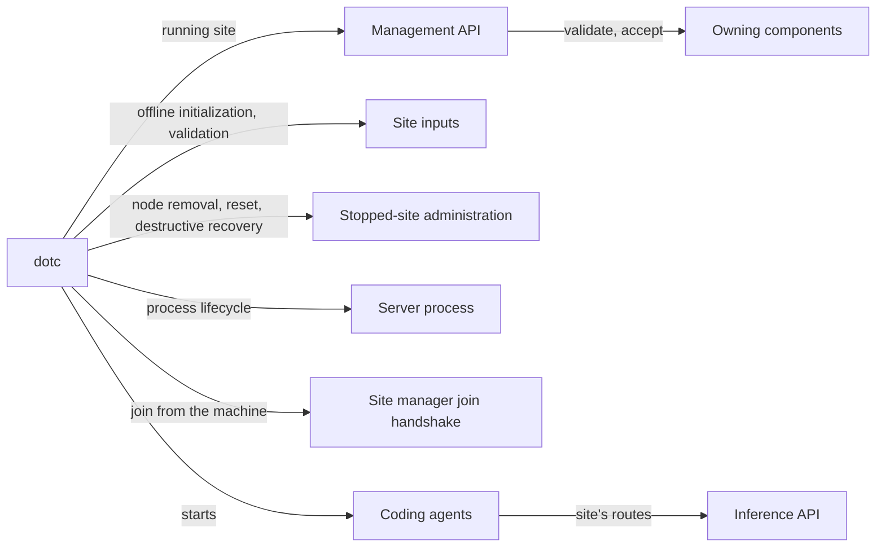
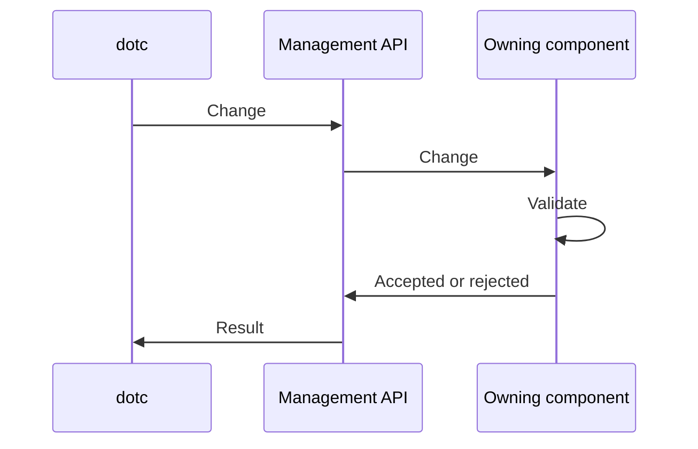
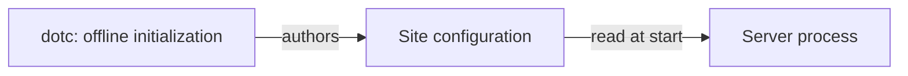

# CLI

`dotc` is Dotcore's command-line client, for local administration and scripted management. The
`dotcore` entry point uses it to run the server.

Code: `backend/cli/`.

## Capabilities

- Initialize and validate a site locally before it starts, then run the server process.
- Add machines to a site, join a machine from that machine, and remove one.
- Manage model and application deployments through the management API, from scripts.
- Start coding agents that use the site's routes, and run one-off development workloads.
- Run exclusive administration on a stopped site: node removal, site reset and destructive
  recovery.

## Architecture

### Managing a running site

- Every change goes through the management API to the owning component, which validates and accepts
  it ([README](README.md#managing-the-site)).

### Before the site starts

- Offline initialization authors the site's inputs before startup
  ([sites](sites.md#site-configuration)). It's a local CLI step, not a console workflow.

## Components

### dotc

#### Responsibilities

- Run process lifecycle, approved offline initialization and validation, and owner-controlled
  management operations.

#### Boundaries

- Owns no product state. The server accepts or rejects every change.
- Runs the stopped-site administration that [sites](sites.md#invariants) defines. None of it is a
  console capability.

## Open decisions

- Validated site reload, post-start configuration tooling and node binding changes
  ([sites](sites.md#open-decisions)).
