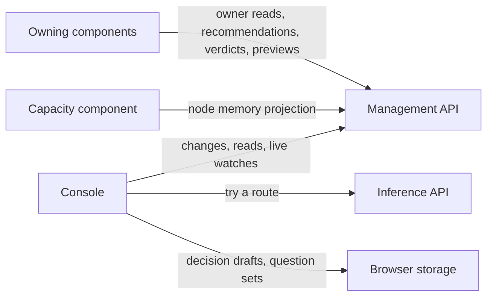
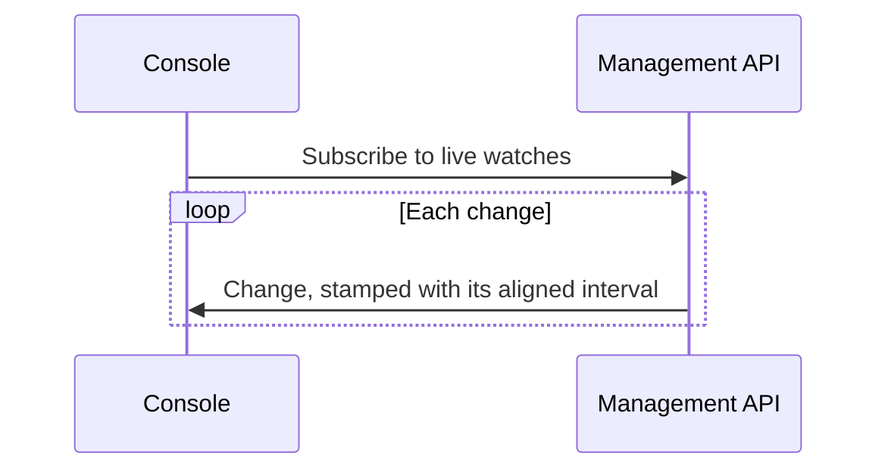
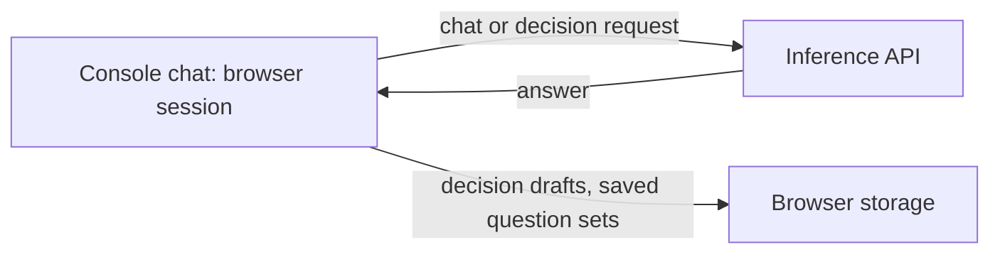

# Console

The console is Dotcore's web client, for graphical management and observation of a site. It is
also an inference client for trying routes.

Code: `frontend/` (its `AGENTS.md` holds the code map).

## Capabilities

- Manage and observe the site, its machines, deployments and routes, through the management API.
- See live updates as the site changes.
- Add a machine: start a join, show the command that installs Dotcore if needed and joins, then
  review the joining machine and approve or reject it
  ([access](access.md#joining-a-node)).
- Remove a machine once its deployments are gone, or forget them for a machine that is not
  connected ([sites](sites.md#invariants)).
- Start with a guided Get started page that proposes, for each use case, a model, an app or both
  that can start now on your hardware ([recommendations](recommendations.md)). The console opens
  on it until it's hidden. A use case whose deployment failed opens on that deployment as failed,
  with its logs, and offers to remove it before proposing the deployment again.
- Check fit and preview memory before deploying, from the server's capacity answers.
- Explore metric history across machines, devices, deployments and routes.
- Try inference routes: conversations with chat routes, and typed questions to decision routes
  through a form or the raw request.

## Architecture

### Watching the site

- The console subscribes to the management API's live watches
  ([README](README.md#managing-the-site)).

### Trying a route

- The chat is an ordinary inference client of the inference API.
- Conversations last for the browser session. Decision drafts and saved question sets are kept in
  browser storage.

## Components

### Console

#### Responsibilities

- Draw what the server answers: owner reads, capacity verdicts, previews, recommendations and
  metrics.
- Offer one size control for the context and for engine memory parameters. The box holds the size
  with its unit, in the largest unit that shows it exactly, and accepts typed binary suffixes. Chips
  offer round sizes and the largest fit; a chip shows as pressed only after a click, and an empty
  box shows the sized value. Memory sliders end at the largest fit the server answers, and the
  largest fits of total context and context per request follow the dialog's values the same way;
  clicking one sets that value.
- Place every catalog-declared input by its catalog visibility, never showing a hidden one.
  Advanced inputs stay off the basic path.
- Ask for context per request and parallel requests before total context. Total context starts at
  the server's starting value and follows the other two, capped at its largest fit, until you edit
  it.
- Hide Get started for the whole site once a ready step shows or the operator dismisses it. The
  profile menu still opens the page without changing the choice. The choice is a site-wide console
  setting, read from and updated through the site manager ([sites](sites.md#site-manager)).
- Explain the impact of actions, confirm destructive ones, and show actionable failures
  ([README](README.md#principles)).

#### Boundaries

- Owns no product state. Site-wide console settings belong to the site manager, not the console.
- Browser storage holds only per-browser preferences and drafts, never a setting the whole site
  shares.
- Holds no fit, headroom, sizing or starting-value rule ([machines](machines.md)). Each figure has
  one source, so two screens never disagree.
- Never shows representative or fixture data as infrastructure-backed.
- The chat has no assistant tools, console actions, attachments or saved history
  ([README](README.md#non-goals)).
- Not used for site initialization, destructive recovery or installing Dotcore on the
  machine that joins ([cli](cli.md)).
