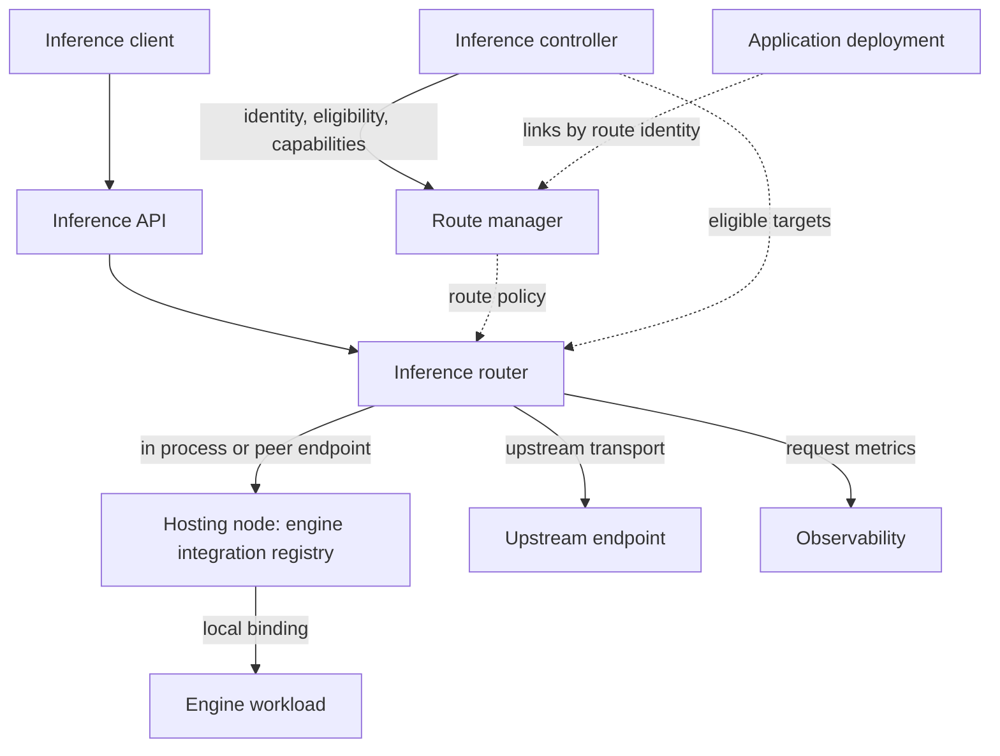
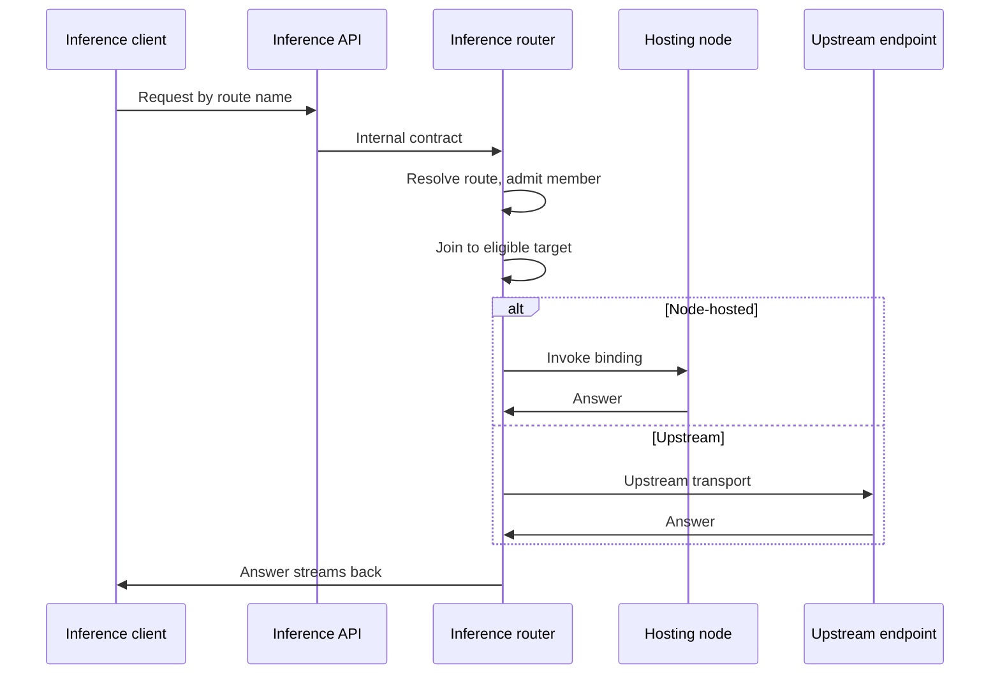
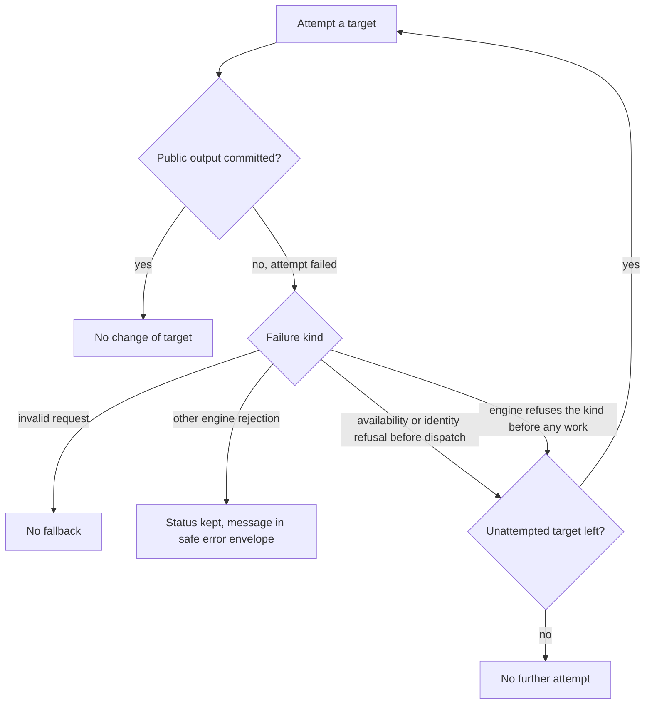
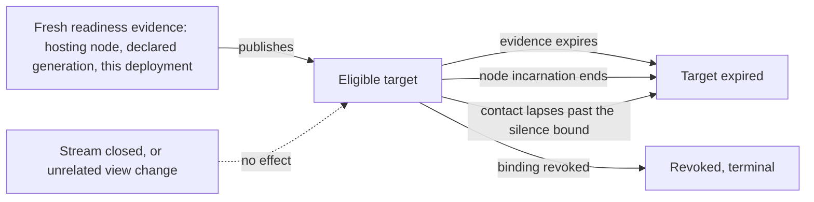

# Inference

An inference route is the callable name clients use. Its members are model deployments. The route
manager owns routes, and the inference router carries every request to a selected deployment.

Code: `backend/core/src/route_manager/`, `backend/core/src/router/`,
`backend/core/src/inference/` (engine-neutral inference contracts).

## Capabilities

- Call models by stable route names, never catalog model or deployment identities.
- Use OpenAI-compatible model discovery, Chat Completions, and stateless Responses with text,
  client-defined function tools and supported image inputs. Supported models keep their reasoning
  output separate.
- Ask decision requests: typed questions answered with per-option probabilities from one model pass,
  through the System One and OpenAI Decisions formats.
- Expose a deployment directly under its own route, or keep it hidden in other routes. Route
  membership doesn't care whether a deployment is local or upstream.
- Create, inspect, rename, enable, disable and delete routes. See their membership and
  availability, and why a route or member is unavailable, without exposing private provider
  configuration.
- Use ordered fallback groups and selection among eligible deployments, within bounded retry safety.
- Get connection information and integration examples for a route.

## Architecture

- The route manager owns routes: identity, callable names, membership, routing policy and
  availability.
- The inference router carries live requests from the inference API. It applies the route policy to
  the eligible targets, dispatches to a node-hosted or upstream target, and records request metrics.
- The inference controller publishes the deployments a route can use ([models](models.md)).

### Serving a request

The router resolves the route, admits the request to an eligible member, and invokes it.

- Public requests resolve by route name, never by catalog model or deployment identity.
- Chat and decision requests travel as inference request kinds through one pipeline. Each public wire
  format decodes into one API-agnostic internal contract per kind, which travels through route
  admission, peer calls and engine invocation unchanged by wire shape.
- A request is admitted only to route members whose engine configuration declares its kind. A kind no
  member declares is an invalid request. A declared kind with no ready member is unavailable.
- Decision requests are non-streaming and text-only. Upstream models serve chat only.
- The router joins the route's selected deployment identity to the controller's eligible target.
  Source-private dispatch data is exposed only after selection.
- Platform-owned request semantics are validated at every entry point. Bounded engine-specific
  generation controls travel only to the admitted target and carry no routing, endpoint, credential
  or deployment authority.
- The router invokes the hosting node's binding after route admission, in process when the node
  shares the router's process, or through the node's authenticated peer endpoint. It never sends
  inference through the runtime.
- Bindings never cross process boundaries, and the runtime backend's identity never selects router
  behavior.
- The site manager's router selects among eligible targets before dispatching an exact deployment to
  its hosting node. The hosting node applies its local binding and owns no route lookup
  or fallback policy.

### Retry and fallback

- No change of target after public output commits.
- No repeat of a deployment already attempted.
- One provider request per upstream attempt.
- An invalid request is never eligible for fallback, wherever it's detected. Only an availability or
  identity refusal before dispatch may move to another target.
- An engine adapter may classify an engine rejection it recognizes as a platform invalid request,
  answered with a platform message. Other rejections keep their status, with their message passed
  through the platform's safe error envelope.
- An engine that doesn't serve the request kind refuses before doing any work, which is safe to fall
  back from.

### Publishing a node-hosted target

- A node-hosted deployment becomes an eligible target only from fresh readiness evidence from its
  hosting node, for the declared deployment generation, scoped to that deployment.
- The target expires with that evidence, with the node's incarnation, or when contact lapses past the
  node's silence bound.
- A closed node control stream and unrelated changes to the node's view don't revoke it, so a stream
  interruption doesn't cancel requests in flight.
- Revoking a binding is terminal.

## Resources

### Inference route

- Has an identity, a callable name, members, a routing policy, availability and status.
- References deployments. Deployments and catalog models aren't directly callable.
- Apps link a route by identity ([apps](apps.md#linking-a-route)).

## Components

### Route manager

#### Responsibilities

- Own route identity, callable names, membership, routing policy, availability and status.

#### Boundaries

- Stays off the live request path.
- Never sees source-private endpoints, credentials or dispatch data.

#### Interfaces

- Receive: deployment identity, eligibility and capabilities from the inference controller.
- Provide: route policy to the router.

### Inference router

#### Responsibilities

- Orchestrate live inference bytes, cancellation, upstream protocol transport and transient request
  selection.
- Apply route manager policy to the inference controller's eligible targets, and dispatch
  node-hosted targets in process or through an authenticated peer endpoint, and upstream targets
  through upstream transport.
- Measure request and per-attempt latency, outcome and token metrics for every public request, and
  record them through observability ([storage](storage.md#recording-metrics)).

#### Boundaries

- Owns neither desired state nor readiness.

## Invariants

- The route manager and the inference controller stay off the live request path.
- Public route identity is preserved while source-private model, endpoint and credential details stay
  isolated.
- Dispatch authority and revocation are scoped to the selected deployment. Changing one target never
  revokes another.
- Connection guidance is distinct from a live inference client, and never promises the endpoint is
  reachable.

## Future direction

- An Anthropic Messages-compatible endpoint on the same routes, bounded like the OpenAI-compatible
  surface.
- Durable Responses storage and continuation, hosted tools, structured outputs and Conversations.
- Batch inference: queued and off-peak work, progress, durable results, and capacity shared with live
  serving.

## Open decisions

- Inference access enforcement, entitlement integration, serving-state persistence and remote
  exposure.
- Routing beyond bounded safe fallback, and external-provider authority.
- Batch inference ownership, scheduling and result retention.
