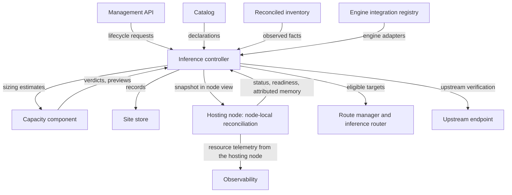
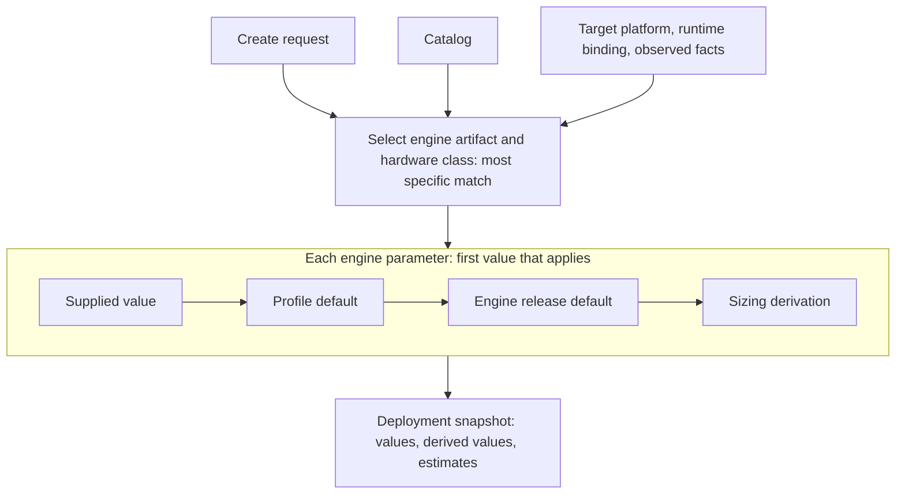
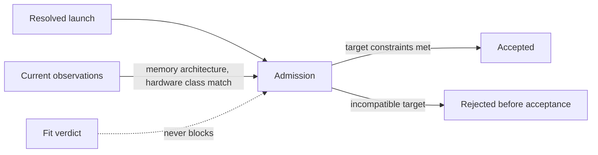
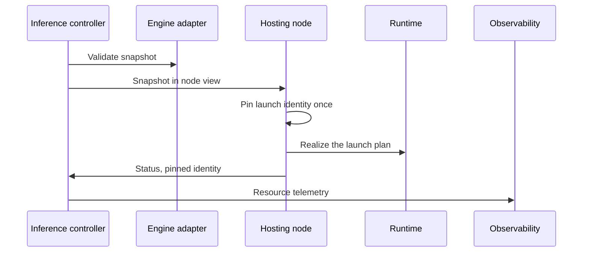
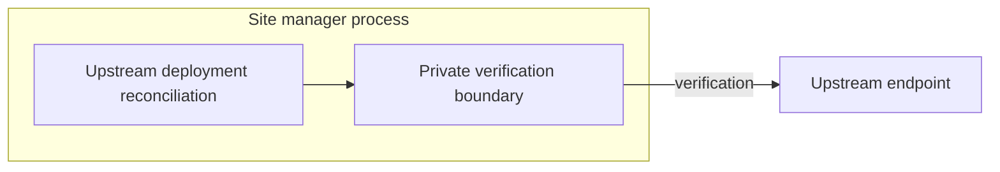
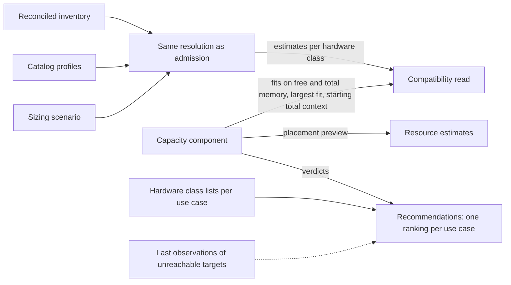

# Models

A model deployment is one deployed model: a local workload on one target, or an upstream endpoint.
The inference controller owns model deployments, from intent to serving eligibility.

Code: `backend/core/src/model/` (inference controller, resolution, engine adapters,
recommendations), `backend/core/src/telemetry/` (workload resource records).

## Capabilities

- Deploy, pause, resume and tear down each deployment.
- Create independently managed deployments of the same model, each with its own configuration and
  execution target.
- Use profiles as presets, and override typed options, engine parameters and expert launch arguments
  when you create a deployment.
- Get model recommendations for your use cases across the site's targets, through a guided quick
  start.
- See which configured targets can run each profile, and narrow the catalog to profiles whose fit
  allows them there.
- See advisory memory estimates for a configuration when measured evidence exists, and its fit on
  each target.
- Inspect a deployment's identity, configuration, lifecycle, readiness, progress, failures and
  diagnostics. See its derived values apart from the values you supplied, before deploying too.
- Add upstream models through one generic OpenAI-compatible template, beside local deployments.

## Architecture

- The inference controller owns model deployments, from intent to serving eligibility.
- The capacity component judges whether a configuration fits and previews its memory use
  ([machines](machines.md)).
- The hosting node runs a deployment and reports its status, readiness and attributed memory
  ([sites](sites.md), [runtime](runtime.md)).
- The controller publishes serving eligibility to the route manager and eligible targets to the
  inference router ([inference](inference.md)).

### Resolving a deployment

The controller resolves a create request against the catalog and the target's observed facts, then
keeps the result as the deployment's snapshot.

- It selects the engine artifact and the hardware class by matching their selectors against the
  target's concrete platform and observed facts. The most specific match wins.
- It selects only engine artifacts of a kind the target's runtime binding can realize, and only
  hardware classes the configuration supports.
- A local request that omits its engine configuration takes the selected profile's default binding.
- Engine parameter values merge per parameter: the supplied value, then the profile default, then
  the engine release default, then the sizing derivation, for every supplied set.
- An omitted context per request becomes the smaller of the maximum context and the total context,
  kept as a derived value.
- It evaluates the declared sizing for the configuration, the selected hardware class and the
  binding, deriving the values the caller omitted and advisory estimates. Supplied values win.
- Engines that need sizing deploy only when the catalog declares it. Derived values aren't verified
  hardware fit.
- Expert launch arguments don't stop derived launch values from applying. Their fit is your risk.

### Admitting a deployment

- Admission enforces target constraints, such as a target's GPUs numbering exactly the devices the
  resolved launch uses, so an incompatible target is rejected before acceptance, not discovered at
  realization.
- Admission rechecks the retained memory architecture and hardware class match against current
  observations.
- Admission never blocks on fit ([machines](machines.md#invariants)).

### Running a local deployment

- The hosting node realizes the deployment through node-local reconciliation on its runtime
  ([runtime](runtime.md)).
- The controller validates the retained snapshot through the selected engine adapter and reconciles
  the retained launch plan, with no catalog lookup or product-configuration translation.
- The hosting node pins the deployment's launch identity ([storage](storage.md#launch-identity)).
- The inference controller records workload resource telemetry on the hosting node for its ready
  local deployments ([storage](storage.md#workload-resource-records)).

### Running an upstream deployment

- Upstream deployments reconcile in the site manager process through a separate private
  verification boundary, outside runtime and any node's realization.
- Running in the site manager process never turns an upstream endpoint into a local workload.
  Endpoint failure affects that deployment only, never healthy local targets.

### Advisory reads

- The compatibility read covers catalog model profiles and configured model targets. It runs the same
  resolution as admission over the reconciled inventory. A target without fresh observations is
  unknown.
- It can evaluate a sizing scenario (total context and optional context per request) and report
  estimates per hardware class and the capacity component's two fits per target: on free memory and
  on total memory. Declared memory minimums always compare with the total.
- For each running target, it reports the capacity component's largest fitting total context and
  starting total context. Narrowing by scenario uses the fit.
- Resource estimates for a launch configuration carry the capacity component's placement preview for
  the selected target.
- Recommendations: each target takes its most specific hardware class's list per use case. Entries
  are kept or dropped by the capacity component's verdicts, entry minimums included, and the result
  is one ranking per use case across the site.
- A target that stopped reporting is judged on its last observations for recommendations, marked
  unreachable with free memory unknown, until its node leaves the site. This is the only read that
  accepts stale observations.

## Resources

### Model deployment

- Every local deployment keeps an exact placement naming one node and one execution target owned by
  that node. Workload controllers reject mismatched pairs instead of choosing or correcting
  placement on the hosting node.

### Deployment snapshot

What a deployment keeps from resolution. Later catalog edits, removals or new artifact alternatives
never redefine it.

- Normalized option values.
- The selected immutable artifacts and their concrete platforms.
- The selected hardware class and its resolved selector.
- Concrete engine state and capabilities.
- The portable launch plan.
- The engine-neutral sizing result when sizing is declared, and which engine parameter values were
  derived rather than supplied.
- The selected target's memory architecture. Engine adapters derive launch settings and non-blocking
  advisories from it.
- The selected target's device memory total, or its host memory total on unified targets. Engine
  adapters derive launch settings from it, never treat it as reserved capacity, and engines that
  need it reject targets without one.

### Portable launch plan

- References the engine executable, artifacts and service endpoints symbolically, never as
  runtime-specific paths, mounts or ports. The runtime resolves them ([runtime](runtime.md)).

### Upstream deployment

- Keeps a template snapshot and a private endpoint configuration.
- Has no local model artifact, engine, runtime workload or exact placement. Dotcore never invents
  local hardware, engine or placement data for it.
- Local and upstream are the only kinds of serving source.

## Components

### Inference controller

#### Responsibilities

- Own model deployment intent, source-specific configuration, lifecycle, placement where it applies,
  reconciliation, readiness, status and serving eligibility.
- Own model option resolution, compatible artifact selection from each configuration's approved set,
  concrete engine state, accepted snapshots and portable launch plans.
- Run the compatibility read, resource estimates and recommendations.
- Project each deployment's GPU memory, as attributed by the hosting node, from that node's current
  status at read time.
- Publish serving eligibility and capabilities to the route manager, and eligible targets to the
  inference router.

#### Boundaries

- Stays off the live request path.
- Never keeps a provider-specific directory or discovers provider models automatically. Upstream
  models come only from the generic OpenAI-compatible template.

#### Interfaces

- Receive: create, pause, resume and teardown requests through the management API.
- Receive: engine adapters from the engine integration registry, for engine-specific validation,
  realization and local engine transport ([runtime](runtime.md#engine-integration-registry)).
- Receive: typed status, readiness and attributed memory from hosting nodes.
- Provide: eligible targets with deployment identity and capabilities to the route manager and the
  router ([inference](inference.md)).
- Provide: derived values and estimates to clients, never catalog sizing declarations.

#### State

- Deployment records and their snapshots, in the site store through its own repository.

## Invariants

- A deployment's memory reads from its hosting node's current status, never from retained state.
  Without current status or attribution, it reads as unavailable
  ([machines](machines.md#attributing-memory-to-deployments)).
- The retained memory total is fixed at creation. Deployments pick up changed hardware only when
  recreated.

## Future direction

- Safe model releases: evaluation comparison, provenance, canary rollout, explicit promotion, and
  rollback with retained capacity.
- Reviewable and exportable release evidence, and governance audit.
- Engine-local request scheduling, prefix-cache reuse and concurrent multi-user serving, qualified on
  representative models and hardware.

## Open decisions

- Release thresholds, exceptions and rollback retention.
