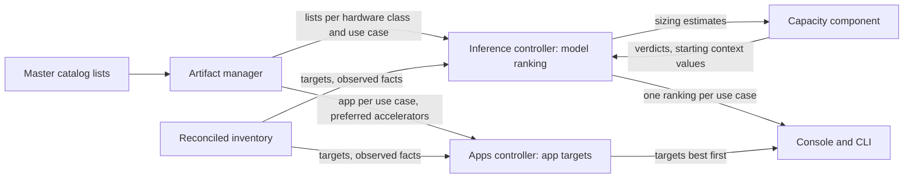
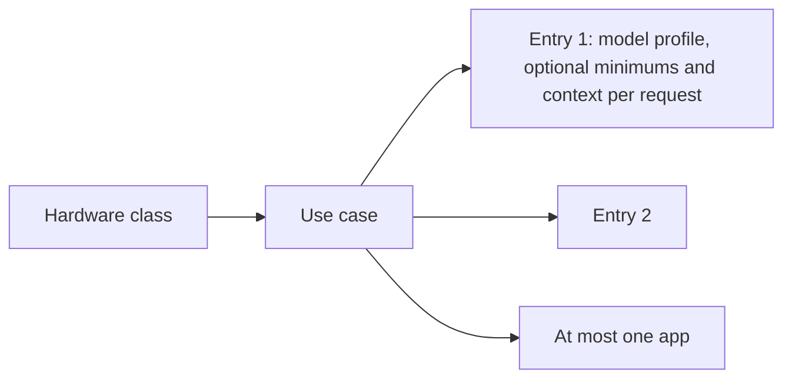
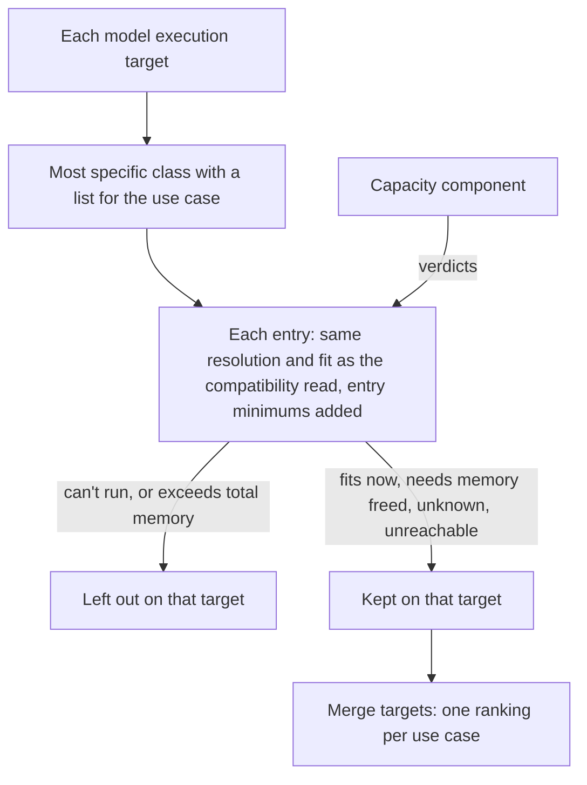
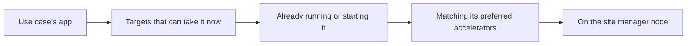

# Recommendations

Recommendations tell you what to run for each use case on the machines you have: a model, an app,
or both. The artifact manager owns the curated lists, the inference controller ranks models for a
site, the apps controller says where an app can run, and the capacity component judges every fit.

Code: `catalog/recommendations/` (the lists), `backend/core/src/model/recommendation/` (model
ranking).

## Capabilities

- Get, for each use case, a ranking of models curated for your hardware, across all the site's
  machines.
- Get the app that serves a use case, and the machine it runs best on.
- Ask only for what can start now, and deploy it in one step from the Get started page.
- See, for each recommended model, which machines can run it, whether it fits beside what runs
  there now, and the context it starts with.
- See what a machine would get before it joins a site, from the machine itself or a machine
  description.
- Deploy anything else. Recommendations advise and never block a deployment.

## Architecture

- The artifact manager loads and validates the lists from the master catalog
  ([catalog](catalog.md)).
- The inference controller ranks the listed models for a site, with the same resolution as every
  other model read ([models](models.md#advisory-reads)).
- The capacity component judges each entry's fit on each target ([machines](machines.md)).
- The apps controller answers where a use case's app can run now ([apps](apps.md)).
- The console's Get started page and the CLI draw the answers ([console](console.md),
  [cli](cli.md)).

### Declaring the lists

Each hardware class may declare, per use case, a priority-ordered list of model profiles. Each use
case proposes a model, an app or both.

- Only the master catalog declares lists and claims use cases for apps. Site and development
  catalogs can't add or replace them.
- Lists name only local models.
- An entry may require more memory than its configuration does, so a small and a large machine of
  the same class get different models.
- An entry may set its own context per request, within its configuration's minimum and maximum
  context. Without one, it starts as a new deployment's does
  ([models](models.md#resolving-a-deployment)).
- Validation rejects an entry that names an unknown model, profile, hardware class or use case; an
  entry whose configuration supports neither its class, a wider class containing it, nor a narrower
  class nested in it; an entry that doesn't accept the requests its use case sends; and an entry
  minimum lower than its configuration's. It reports every problem, not only the first.
- The classes that declare lists are disjoint or strictly nested, so a target's list is never
  ambiguous.

### Ranking models for a site

- Each target takes the list of its most specific hardware class that has one for the use case. A
  class without a list for that use case falls back to the closest wider class that has one.
- Each entry is sized as a new deployment starts: its context per request at its profile's parallel
  requests, with total context following them and capped at the largest fit. It is judged with the
  compatibility read's resolution and the capacity component's fit, and its minimums add to its
  configuration's and compare with total memory.
- An entry fits a target when a deployment would start there at its context per request, without
  lowering it.
- An entry is left out on a target when its profile can't run there or serve its context, or when
  its context per request doesn't fit the target's total memory that way.
- A kept entry fits now, needs memory freed first, has an unknown fit (free memory can't be judged
  yet), or is unreachable.
- Rows merge across targets and rank by their best declared position on any target, then by the
  model's intelligence score, then by a stable identity order.
- Each row names the targets that can run it, with the fit, the starting context values, and the
  running or starting deployment of the same profile there.
- A caller may ask for what can start now: rows keep only reachable targets that already run the
  profile or fit free memory, and rows with a running or starting deployment come first.
- A target that stopped reporting is judged on its last observations, marked unreachable with free
  memory unknown, until its node leaves the site. This is the only read that accepts stale
  observations.

### Proposing an app

- A target can take an app when its node reports it freshly, its runtime runs the platform the site
  declares for it, and every service of the app approves that platform.
- Targets rank best first: those already running or starting the app, then those with accelerators
  of a vendor the app prefers, then the site manager node's.
- An app with no preferred accelerators matches every target. When no target matches an app's
  preference, the answer shows it, so a client can warn that the app runs slowly there.

### Recommending without a site

- The CLI builds a machine's execution targets the way site setup does, from the machine it runs
  on or a machine description, with nothing running, and runs the same ranking.

## Resources

### Model recommendation

The lists one hardware class declares: per use case, a priority-ordered list of model profiles, each
with optional memory minimums and an optional context per request.

- An immutable master-catalog declaration, one per hardware class.
- Sizes every recommended entry: a ranking row is one model, profile and context per request.

### App use case

- An app may name the use cases it serves, at most one master-catalog app per use case, and the
  accelerator vendors it prefers.
- Both are recommendation and display metadata, declared in the app's catalog entry.

## Components

### Artifact manager (recommendations role)

#### Responsibilities

- Load the lists and app use cases from the master catalog, and validate them.

#### Boundaries

- Never ranks or judges fit. The inference controller ranks and the capacity component judges.

### Inference controller (recommendations role)

#### Responsibilities

- Rank each use case's listed models for a site, over its model execution targets and their
  deployments.

#### Boundaries

- Holds no fit rule of its own. Every kept or dropped entry is the capacity component's verdict.
- Never recommends upstream models.

### Apps controller (recommendations role)

#### Responsibilities

- Answer which application targets can take an app now, best first.

#### Boundaries

- Never chooses a target for a deployment. A deployment still names its exact target.

## Invariants

- Recommendations, app use cases and preferred accelerators are advisory. They never affect
  admission, placement, fit or reservations.
- Every fit comes from the capacity component, the same answer the compatibility read and the
  memory views give ([machines](machines.md#invariants)).
- Clients draw the rankings as answered and hold no ranking or fit rule.
- Only the master catalog shapes recommendations.

## Future direction

- Host memory: recommend models that keep part of their weights, such as MoE experts, in system
  memory, for machines with a small GPU and a lot of host memory.
- Speed: weigh measured prompt processing and generation speed on the hardware class, not only the
  curated order.
- Several GPUs: entries that require a GPU count, for tensor parallel on one machine, then models
  spanning several machines.
- Finer hardware classes where lists differ, such as Apple chips with more memory bandwidth.
- Recommendations across the console: recommended profiles first in the model catalog, and a
  recommendation step when deploying another model for a use case.
- Launching a model starts with the Get started questions; the full deploy dialog stays as the
  advanced path.

## Open decisions

- How measured speed, context size and model quality weigh against the curated order.
- Which hardware facts beyond memory an entry may require: host memory for offloaded weights, GPU
  count, memory bandwidth.
