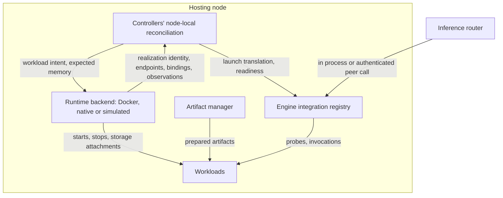
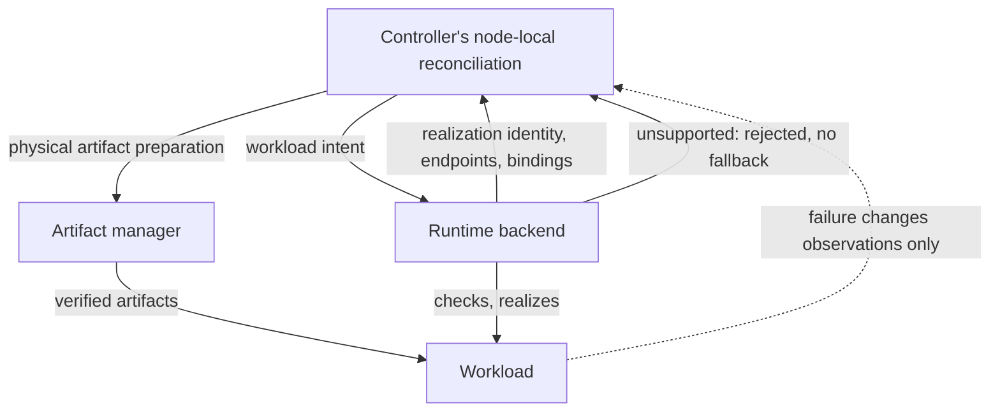
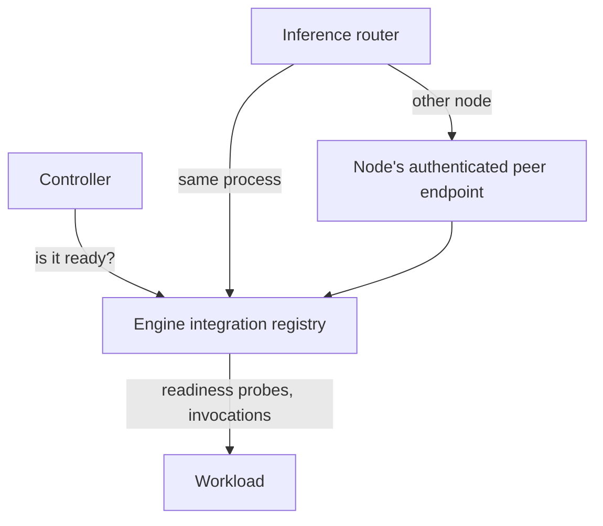

# Runtime

The runtime starts, watches and stops workloads on one machine: model engines and app services. It
runs them as Docker containers, native host processes or simulations. The runtime backends and the
engine integration registry own it.

Code: `backend/runtime/` (owner-neutral contracts), `backend/runtime_backends/`,
`backend/launcher/`, the engine integration in `backend/core/src/model/engine/`.

## Capabilities

- Run models and apps on Linux with Docker and NVIDIA GPUs.
- Run models as native llama.cpp processes on a Mac, and apps in Docker Desktop.
- Restart the Dotcore server without stopping native workloads.
- Run a development site on a declared machine, without its hardware, and see memory and fit
  behave as on the real machine.

## Architecture

- Runtime backends realize workloads on their own machine.
- The engine integration registry turns a realized workload into readiness checks and inference
  bindings.
- Workloads are the engines and app services that run.

### Realizing a workload

The controllers decide what should run. On each hosting node, their node-local reconciliation hands
the runtime backend a workload intent: what to launch, with which artifacts, devices and storage.
The backend realizes it and reports back what it started and where it listens.

- The runtime materializes owner-neutral workload intent for its target, including resolving its
  symbolic executable, artifact and service references. It never interprets catalog entries or
  engine options.
- The backend checks the destination against the workload's retained constraints, including platform
  and artifact kind, before launching.
- Physical artifact preparation belongs to the artifact manager ([storage](storage.md)). The runtime
  owns virtualized startup. Controllers keep the operation's progress, failure and cancellation.
- Runtime failure changes observations, never desired intent.

### Serving through a workload

The controller asks the registry whether a workload is ready, and the router asks it to invoke the
workload's binding ([inference](inference.md#serving-a-request)).

- Inference requests and readiness probes never go through the runtime backend.

## Resources

### Realization

One realized workload on one backend.

- Its realization identity includes every isolation-sensitive part of the intent, so a changed
  isolation requirement never reuses an incompatible workload.
- It keeps running across server restarts and is rediscovered from ownership evidence, unless its
  runtime binding ties its lifetime to the server process. Rediscovery fails closed.

### Storage attachment

Node-local storage a workload asks for.

- Its kind is a recreatable cache or app data. Its namespace and key are chosen by the owner.
- Owners mark storage shared beyond one deployment as expiring when unused. The runtime records when
  such storage was last used.

### Workload cache

Recreatable workload scratch, kept per site on each machine and keyed by its owner: one deployment,
or one engine artifact.

- It isn't a product artifact, inventory or desired state.
- Site reset and deletion remove the site's caches on the machine they run on. Shared workload storage
  falls under [machine cleanup](storage.md#machine-cleanup).

### Native workload state

The state and logs of native workloads, kept in the site's folder, apart from the node store. Not
product state.

- Ownership evidence names the site, the node and the canonical state location, so removing native
  workloads never needs the site's identifier.

## Components

### Runtime backends

Each backend realizes workloads for one kind of target:

- Docker runs workloads as containers on Linux targets. On a Mac, Dotcore reaches Docker Desktop.
  Its linux/arm64 target reports no GPU, so GPU apps run on the CPU there.
- Native runs each workload as a host process on the host platform, darwin/arm64 included, held by a
  launcher process per workload.
- Simulated runs workloads on the node's declared machine. Each model workload uses its resolved
  estimate of that machine's memory, and each running app unit a fixed synthetic share of its host
  memory and CPU time, so observations, capacity and fit move as on the real machine. Its targets
  name the declared GPUs and pass the same checks as real targets. It never downloads engine
  artifacts.

#### Responsibilities

- Realize workload intent on infrastructure local to their hosting process.
- Publish each workload's primary endpoint on the host port its owner asks for.
- Resolve site host names for their workloads and pin them as host entries.
- Provision the storage attachments the intent asks for, by kind, namespace and key.
- Advertise which optional, isolation-affecting realization features they support.
- Rediscover their workloads after a restart from ownership evidence.

#### Boundaries

- Own no product state. Don't choose placement, resolve catalog profiles, judge product readiness,
  or make reconciliation decisions. The controllers do.
- Never substitute another artifact, platform, device set or target, and never fall back silently to
  another backend.
- Don't prepare or cache product artifacts. A virtualized backend owns its own startup but claims
  neither artifact transfer nor the artifact cache.
- Never hand host paths to owners. Owners name storage, and the backend maps it.
- May expose infrastructure diagnostics, but never collect or retain telemetry.
- Controllers never select or list backends.
- A runtime that launches from artifact references alone, like the simulated one, follows the
  synthetic launch identity rules in [storage](storage.md#launch-identity).
- Simulation isn't a catalog engine kind, a routing authority or a product-state owner.

#### Interfaces

- Receive: owner-neutral workload intent, which doesn't depend on who sent it.
- Receive: the workload's expected memory per GPU and in host memory. The simulated backend uses it,
  and real backends ignore it.
- Return: the exact realization identity, service bindings as opaque names, assigned endpoints, the
  target's effective platform and other infrastructure observations.
- Return: each local workload's host process identity, qualified by node, so the node can attribute
  memory. It's a passing observation, not product state or telemetry.
- Return: the point-in-time CPU time and memory use of the workload groups they own, on request,
  where the infrastructure exposes it. Otherwise "unavailable", never an estimate.
- Return: whether the workload's assets must be physically present on the host, or are virtualized.
- Reject: an explicit requirement they don't support, before creating the workload, with no silent
  fallback.

### Engine integration registry

Typed engine adapters, one per engine kind.

#### Responsibilities

- Translate launches per engine kind, materialize them as runtime workloads, run readiness probes,
  and create inference bindings.
- Give engine adapters a way to turn a backend's opaque service bindings into
  readiness and invocation capabilities.

#### Boundaries

- Owns no product state.
- Works the same whichever runtime backend realized the workload.

#### Interfaces

- Shared by composition between controller readiness and router invocation.

#### State

- Keeps each exact binding only in the process that hosts the realization.

### Workloads

- Inference engines are model servers that run inference, distinct from engine release declarations
  in the catalog.
- App workloads are running instances of hosted apps.
- Development tooling may run its own transient workload through the runtime. It creates no product
  state or serving eligibility, and roots no artifacts.

#### Responsibilities

- Inference engines serve requests for one model deployment through the bindings the engine
  integration registry creates.
- App workloads run hosted app services. They reach models at the inference base URL, through their
  linked inference route ([apps](apps.md)).
- GPU apps download their own checkpoints into app storage, which later deployments of the app on
  that machine reuse.
- Use only the devices, storage attachments and host port their workload intent names.

#### Boundaries

- Own no product state and don't judge their own readiness. The workload controllers do.
- Get no platform credentials, site store access, control-plane interfaces or host runtime
  privileges.
- Keep IPC isolated by default. Shared host IPC is a narrow, explicit workload requirement. It grants
  no extra devices, credentials, mounts, network exposure, privileged execution or product
  authority.
- Never rely on their container's DNS for site host names. The runtime backend pins them.
- Users never reach an app through private workload ports. They use app access ([apps](apps.md)).
- A workload's failure changes observations, never desired intent
  ([realizing a workload](#realizing-a-workload)).

## Invariants

- Any change to a workload fails closed when ownership evidence is missing, foreign, malformed or
  ambiguous. Dotcore never adopts workloads or execution targets it doesn't own.
- A reset, delete or node leave touches only workloads recorded under its own state location, and
  never another site's state. A copied site folder never adopts or changes the original's workloads.

## Future direction

- Host and workload isolation as a supported capability.

## Open decisions

- Additional runtime adapters, distributed engine profiles and the remaining isolation mechanics.
- Cache size limits and automatic reclaim of workload storage.
