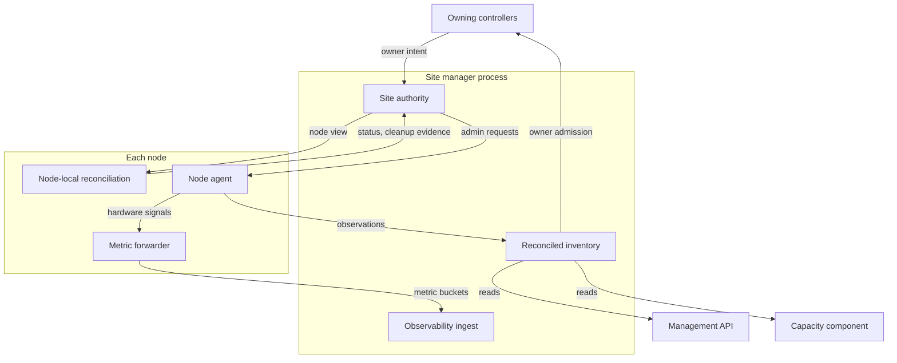
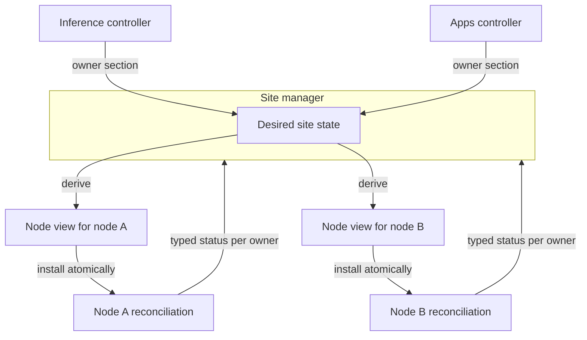
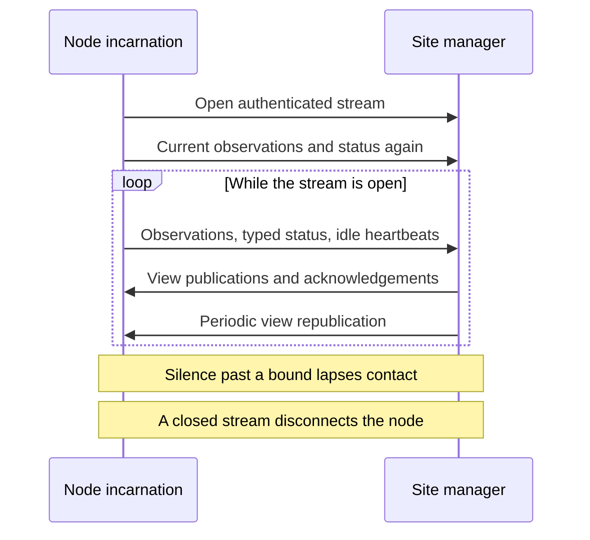
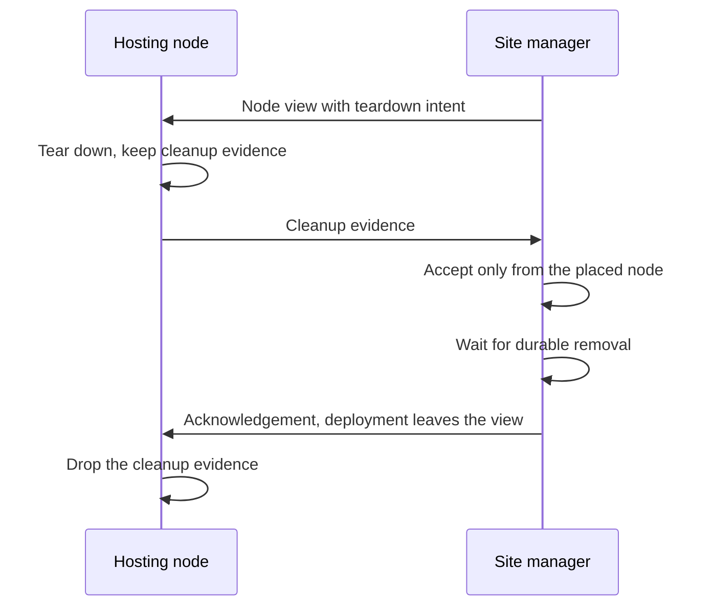

# Sites

A site is one Dotcore installation: one or more machines, each a node, managed together. The
site manager holds the site's authority, and a node agent on each machine reports its hardware.

Code: `backend/site/` (site authority, stores, desired views and fencing, membership), the node
connection in `backend/core/src/server/`.

## Capabilities

- Create a site on one machine, then add and remove machines.
- See each node's membership, health, connection and maintenance state, and which node runs the site
  manager.
- Keep serving on every node while the site has no connection to Dotcore's cloud
  ([access](access.md#invariants)).
- Reset a stopped site, then provision its workers again ([access](access.md#connecting-nodes)).

## Architecture

- The site manager owns site identity, membership, topology and the reconciled inventory.
- Each node runs node-local reconciliation for the deployments placed on it, on behalf of the
  workload controllers.
- The node agent reports the node's hardware and runs node administration. It never touches
  workloads.

### Distributing node views

The site manager derives one complete, revisioned node view per node from the desired site state.
Each node installs its view and reconciles toward it.

- Distribution, acknowledgement and fencing are generic control-plane capabilities. Typed owner
  sections inside a view keep each controller's authority.
- A node view holds only the destination node's realization configuration and typed owner intent.
  Unrelated topology, route policy, trust custody, upstream credentials, artifact bytes and mutable
  cache state stay out of it.
- An app's owner section carries a linked route's identity and name as part of its launch, never
  route policy or live availability.
- A node installs each view atomically and reports typed controller status without becoming a
  product-state owner.
- Transport acceptance isn't workload readiness. One owner section's progress never gates another's
  status.
- An invalid owner assignment fails only that deployment. It doesn't reject the node view or freeze
  other owners.
- Owners never resolve development artifacts or probe app data. The hosting node does both.
- The node view is disposable and read-only. Every node, the site manager node included, realizes
  workloads only from it.

### The node control stream

Each node incarnation holds one long-lived authenticated stream to the site manager. Observations
and typed controller status flow up. View publications and acknowledgements flow down.

- The site manager accepts or rejects each message on its own, under the generic fencing.
- A newer stream of the same incarnation replaces the older one.
- On every stream open, the node sends its current observations and status again. Neither end
  buffers node state across a reconnect.
- Any message counts as contact. An idle node sends a heartbeat, and contact lapses after a silence
  bound. Metrics, which travel over the [authenticated node channel](storage.md#architecture),
  never count as contact.
- When a stream closes, its node is disconnected at once, unless a newer stream of the same
  incarnation replaced it.
- A new incarnation is admitted only after the previous incarnation's stream has closed or fallen
  silent.
- The site manager republishes each node's current view periodically. That keeps the node's action
  fencing current and serves as the site manager's heartbeat. A node reopens its stream when the
  site manager stays silent.
- Nodes take readings on epoch-aligned slots, so readings from every node in one slot describe the
  same moment.

### Cleaning up a withdrawn deployment

- A withdrawal reaches the hosting node as teardown intent in its node view, never as absence. The
  node tears the workload down, keeps cleanup evidence for that teardown generation and reports it
  in its status until the site manager acknowledges it.
- The deployment leaves the view only once it's removed, and the node drops acknowledged evidence
  whose teardown the view no longer carries.
- The site manager accepts cleanup evidence only from the node named by the deployment's exact
  placement, and acknowledges it only after the teardown's removal is durable.
- A deployment withdrawn by removing its node finalizes without cleanup evidence. Only the removed
  node can clean up what remains, using exact site and execution-target ownership evidence. The
  site manager never does.

## Resources

### SiteNode

A node's stable membership in the site, not its health or workloads.

- Removing a node also withdraws its identity pin ([access](access.md#joining-a-node)).

### Site configuration

The site's declared machines, their execution targets, and its settings, authored before the server
starts.

- Offline initialization writes these inputs. It never changes a running site or bypasses deployment
  owners, except through node removal.

### Server-local node binding

What tells one server process which declared node it is.

- It selects declared membership. It can't declare membership or become site desired state.

## Components

### Site manager

#### Responsibilities

- Own site identity, membership, topology and runtime configuration, and the reconciled inventory,
  health and maintenance view.
- Own the site-wide console settings: operator choices about how the console behaves for everyone
  on the site, such as whether Get started is hidden. They are desired configuration of the site,
  kept with it and never mixed with observations or history.
- Hold authoritative site intent and owner-controlled management in the process bound to the
  site manager node.
- Request node facts and supported administrative actions from node agents.
- Own the reconciled, node-scoped view of current hardware observations ([machines](machines.md)).
- Receive each node's hardware observations and typed controller status over its node control
  stream.
- Derive each node's liveness from its current incarnation's stream, the site manager node's own
  included.
- Judge observation freshness and status freshness separately, each by its own age.
- Host observability's ingest of node metric buckets ([storage](storage.md)).

#### Boundaries

- Doesn't place or operate workloads. Workload controllers and their node-local reconciliation do.
- Workload controllers and the route manager keep authority over their own configuration records.
- Node observations feed only the current-observation view, admission, liveness and freshness.
  Metric timestamps never set freshness.

#### Interfaces

- Receive: node observations and typed controller status, over the node control stream.
- Provide: node views, view republication and acknowledgements.
- Provide: the reconciled inventory, read by the management API, owner admission and the capacity
  component, instead of node-local transport.
- Receive and provide: the console settings, read by the console and updated by it one setting at a
  time. Updating them never wakes controllers or changes any node's view.

### Node agent

#### Responsibilities

- Consume the node-local infrastructure configuration derived from the site.
- Probe the configured execution-target infrastructure through bounded, read-only capabilities.
- Supply hardware, capacity and health observations and the results of node management to the site
  manager.
- Sample hardware signals and record them through observability's node-local metric forwarder.

#### Boundaries

- Keeps no site membership or topology authority.
- Infrastructure being available doesn't prove that a workload fits, is ready to launch, or is
  realized.
- Never inspects or manages workloads, receives workload instructions, or calls runtime backends.
  Its observations qualify infrastructure but never supply desired state or runtime configuration.
- Keeps no metric history.
- Per-process resource observations stay on the reporting node and carry no product workload
  identity.

### Site manager node

The node that hosts the site manager process.

#### Responsibilities

- Run the model and application deployments placed on it, like every other node, realized only
  from its node view ([distributing node views](#distributing-node-views)).
- Report typed controller status and cleanup evidence, and keep its liveness through its current
  incarnation's node control stream, like any node.
- Hold its own site-issued node identity ([access](access.md#joining-a-node)).

#### Boundaries

- Has no separate head or master role.
- Has no separate connection state. Clients see it as a node like any other, marked as the one that
  runs the site manager.
- It uses the same node-local reconciliation, status and cleanup evidence, action fencing,
  diagnostic reads, serving admission and observations as any node. Only its transport differs: it
  uses in-process adapters, so it needs no private listener.
- Sharing the site manager's process grants it no extra authority. It reads owner intent only
  through its node view, and owners accept its status, cleanup evidence and readiness through the
  same boundary as any node.

## Invariants

- Each kind of mutable product state has one owner, and each component writes only its own records.
- The running site's shared in-memory desired state is the authority. Persistence never becomes a
  competing authority.
- A persistence failure is reported without rolling back the accepted in-memory change. Such a
  change stays authoritative but can't justify irreversible effects on other nodes until it's
  persisted.
- Desired configuration stays apart from observations, progress and history.
- Operations spanning owners go through each owner's acceptance boundary. Creating a deployment with
  its direct-exposure route, and tearing down a deployment with the routes only it serves, are each
  all-or-nothing in site authority.
- Resource identities are portable and independent of runtime-native identities.
- The accepting owner keeps the audit of accepted changes and the status of operations.
- Removing a node is an exclusive administrative action on a stopped site. In one revision, it
  withdraws the deployments placed on that node and the routes they alone serve, using the owners'
  teardown rules.
- Resetting a site is an exclusive administrative action on a stopped site, not reconciliation or a
  console capability. It rotates the site's trust, so its workers are provisioned again
  ([access](access.md#connecting-nodes)), and it removes the site's caches on the machine it runs on
  ([runtime](runtime.md#workload-cache)).
- Destructive recovery of a stopped site is an exclusive administrative boundary, not reconciliation
  or a console capability. It needs exact ownership evidence before it cleans up infrastructure.
- Freshness is an age on the clock of the process that holds the observation: the site manager ages
  a node's observation from when it received it, and a node ages its own collection from when it
  read it. No node clock sets the site manager's freshness.

## Future direction

- Drain and maintenance operations with impact previews, and protection against disruptive or
  over-capacity actions.
- Multi-machine fleet operations: cross-node inventory and workload attribution.
- Signed updates, rollback, backup and restore, and recovery.
- During a cloud outage, mark remote views as stale and remote controls as unavailable.

## Open decisions

- How the site reloads validated configuration after start, the tooling for it, and changing a
  node's binding.
- High availability for the site manager.
