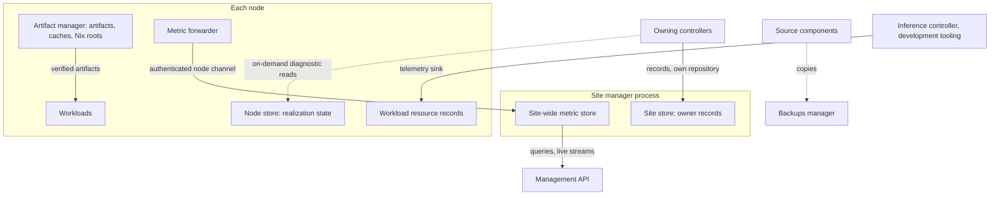
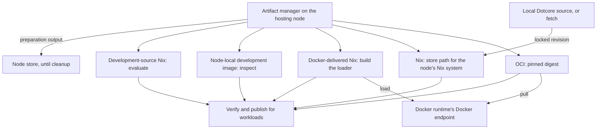
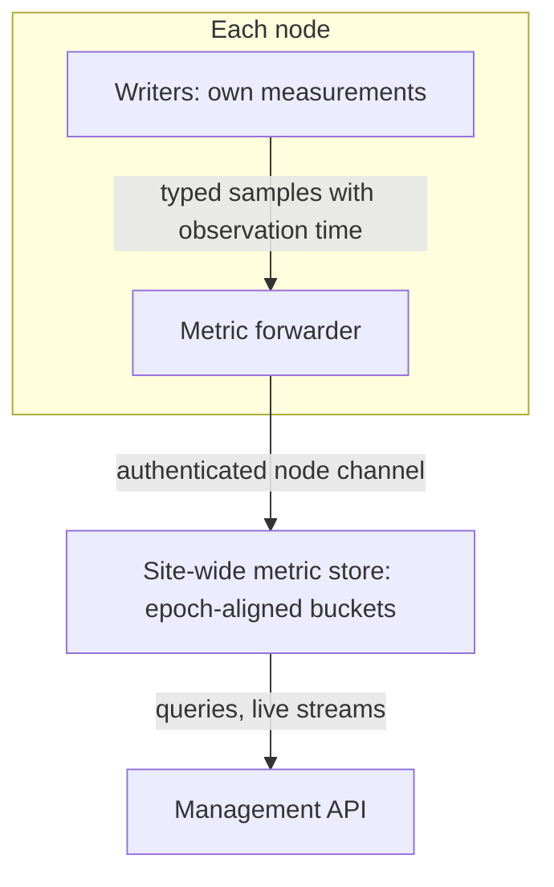
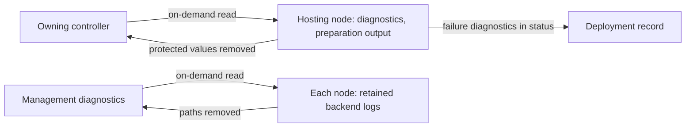

# Storage

What Dotcore stores, where, and who owns it: artifacts and caches, durable records, node state,
metrics, logs and diagnostics, and backups. The artifact manager, the site store, observability and
the backups manager own them.

Code: `backend/artifact/`, `backend/site/` (site store and node store), `backend/observability/`,
`backend/core/src/{diagnostic,deployment_logs}/` and `backend/core/src/metrics.rs` (logs and metric
transport).

## Capabilities

- See operational health, metrics, logs, traces and freshness, never implying observations that
  don't exist.
- See artifact provenance, verification and cache use, and keep artifacts available while
  deployments use them.
- Reclaim image disk no deployment uses, and shared workload storage unused for a configurable time.
- See metric history on one time axis across machines, devices, deployments and routes, with live
  updates, gaps where nothing was observed, and where retained history begins.
- Get a site-wide overview of inference and machine metrics over a chosen time range, leading to
  each deployment, route and machine.
- See hardware metrics (memory, CPU, GPU use, power, temperature, storage), per-deployment resource
  use, and request metrics, per site, machine, device, deployment and route. History is kept in
  memory, is lost on restart, and isn't usage accounting.
- Read workload and backend diagnostics, apart from platform telemetry. Access to logs doesn't imply
  durable retention, complete history, productized telemetry or remote-access security.
- See configured and observed protection honestly. Nothing implies a backup or recovery guarantee
  without support and configuration.

## Architecture

### Preparing an artifact

The artifact manager prepares each artifact on the hosting node, verifies it, and publishes it for
workloads.

- OCI artifacts: it asks Docker to pull the pinned digest for the retained concrete platform, then
  verifies the pinned repository digest and the realized operating system and architecture, with an
  empty variant.
- Nix artifacts: it prepares the store path for the node's own Nix system and verifies the built path
  matches. The flake reference is kept as provenance, not identity. A Nix artifact's package
  provides a native executable or a Docker image.
- A locked revision builds from a local Dotcore source when one holds it (the source the packaged
  runtime was built from, or the development checkout), and is fetched otherwise. The store path
  match verifies it either way. `self` resolves only through the hosting node's development source.
- Docker-delivered Nix artifacts: it builds the node's loader, runs it against the Docker endpoint
  the Docker runtime uses, and verifies the realized image against the identity its image derivation
  records.
- Node-local development images: it resolves an immutable image identity in the node's image store
  and prepares it by inspecting that identity, never pulling.
- Development-source Nix artifacts: it evaluates the store path from the node's own development
  source.
- It publishes verified artifacts of every kind without invalidating content that workloads may
  still use.
- It reports preparation output to its caller and keeps none. The hosting node keeps bounded
  preparation output per deployment in its node store until cleanup is confirmed.

### Recording metrics

- Writers own measurement and observability owns retention. Recording never blocks the measured work.
- Every node sends its metrics through a node-local forwarder to the site manager over the
  authenticated node channel. A node writes only metrics it measured about itself.
- Metrics are typed, with stable identity labels, and aggregated into time buckets aligned to the
  epoch, so all sources share timestamps. They're served as queries and live streams through the
  management API.
- A metric sample carries its observation time. Alignment across nodes assumes synchronized node
  wall clocks.
- A gauge reading stays valid for its sample interval plus its reporting delay. Metrics a node can
  only measure from its full hardware collection use the site's hardware refresh interval as their
  sample interval and are recorded once per collection.

### Reading diagnostics

- The owning controller reads a node-hosted deployment's diagnostics on demand from the hosting
  node's local runtime. Preparation output is read the same way.
- Management diagnostics read each node's retained backend logs on demand from that node.
- On-demand reads cross neither the node agent nor observability, and aren't retained.
- Bounded failure diagnostics a hosting node reports in deployment status are kept on the deployment
  record.
- The hosting node removes protected launch values from deployment diagnostics, and each node removes
  filesystem paths from backend diagnostics, before the data leaves the node. Preparation output
  keeps host paths.

## Resources

### Artifact identity

- An immutable remote artifact is identified by its OCI digest or its evaluated Nix store path.
- A Docker-delivered Nix artifact is identified by its loader's store path. Its loader program and
  Docker launch reference derive from that store path alone, so neither the catalog nor a snapshot
  names a loader or holds a Docker reference.
- A Docker image ID is never an artifact identity, except for node-local development images, which
  are identified by image ID.
- Development-source artifacts are identified by their evaluated Nix store path. The flake reference
  and package are provenance.

### Launch identity

- Every app service and engine artifact selection keeps an immutable launch identity before
  realization: an immutable remote artifact or a development artifact.
- The node named by the exact placement pins a node-specific launch identity once: a local
  development image ID, checked against the retained platform, or a Nix store path for its own Nix
  system, evaluated from its development source or chosen from a locked artifact's catalog store
  paths.
- A target whose runtime launches from artifact references alone, such as a simulated one, pins
  without Nix or Docker: a synthetic identity of the same shape, or any of a locked artifact's catalog
  store paths.
- The owning controller keeps the pinned identity and never resolves it again for the same
  deployment. Development workload tooling pins its transient workload the same way on the node that
  runs it.

### Nix roots

- Every Nix artifact a node pins keeps a garbage-collector root while the node pins it. The root is
  released once the deployment's cleanup is confirmed. Transient development workloads and synthetic
  launch identities root nothing.
- Roots sit beside the node store in the site or node folder. They're derived from the node's pins,
  can be recreated, aren't records, and need no backup.

### Docker image cache

- Docker images realized from Nix artifacts are a machine-wide cache. They're released only when no
  Nix root on the host keeps their loader, through operator-triggered cleanup that never removes an
  image a container uses.
- The same machine cleanup removes shared workload storage, from any site on the machine, that no
  container mounts and no workload has used for a retention period.

### Site store

- Site-local durability through owner-specific repositories. Each component keeps authority over its
  own records.
- Records are independent of the storage implementation.

### Node store

- The hosting node's disposable realization state, cleanup evidence, resolved launch identities and
  bounded preparation logs, apart from site store records.
- Owners learn of it only through accepted status and on-demand diagnostic reads.

### Workload resource records

- A node-local dataset of the records the inference controller and development tooling send through
  observability's telemetry sink: resolved launch inputs, the hardware class and observed GPU memory,
  never protected values.
- They have no query, export or console surface. Development tooling reads them directly to fit
  catalog sizing constants per hardware class.

### Backups

- A backup is custody of copies, never a transfer of the source's authority.
- Nothing is protected until coverage is supported and configured. Native workload logs, preparation
  logs and live process records sit inside the site folder and fall under the open backup coverage
  decision.

## Components

### Artifact manager (artifact role)

The artifact manager also owns catalog declarations ([catalog](catalog.md)).

#### Responsibilities

- Own product artifact verification, storage, transfer, inventory and cache lifecycle.
- Coordinate one writer per publication across backend processes that share an artifact cache.

#### Boundaries

- Sharing cache custody grants no shared site authority.
- A cache's location never defines product inventory or desired state.

### Site store

#### Boundaries

- Owns no product state, app data, artifact bytes, telemetry or secrets.
- Site-local durability doesn't allow several backend controllers for one site at once. Shared
  controller authority needs separate state coordination.

### Observability

#### Responsibilities

- Own collected and retained metrics, logs, traces, diagnostics and alerts.
- Own the site-wide metric store, hosted with the site manager behind a backend-neutral boundary.
- Keep the node-local workload resource records.

#### Boundaries

- Doesn't own node health, deployment status, operation status or routing readiness.
- Direct diagnostic access doesn't transfer ownership of retained logs.

### Backups manager

#### Responsibilities

- Own backup sets.

#### Boundaries

- Source components stay authoritative for the records it protects.

## Invariants

- Where data is stored, or over which protocol, never changes who owns it.
- Catalog declarations, artifact bytes and caches are distinct from each other, and from app and
  customer data and backups.
- Recording metrics never slows the work measured. Metric history is operational, never usage
  accounting.

## Future direction

- Artifact metadata, immutable revisions, transfers between machines, cache visibility and automatic
  cleanup.
- Customer-configured local, network and object storage, through storage adapters.
- Broader resource and workload telemetry, diagnostics and durable history.

## Open decisions

- Artifact and storage adapters, and registry credentials.
- Cache management: stale staging cleanup, automatic image cleanup, model cache garbage collection,
  OCI and development image cleanup, build cache policy, and the artifacts of abandoned site or node
  folders.
- Supported storage backends and protection enforcement.
- Backup coverage, app data protection, retention, recovery objectives and restore coordination.
- Durable telemetry, audit and batch result retention, and how workload resource records are
  retained and aggregated.
- Health thresholds, metrics export requirements and external time-series backends.
